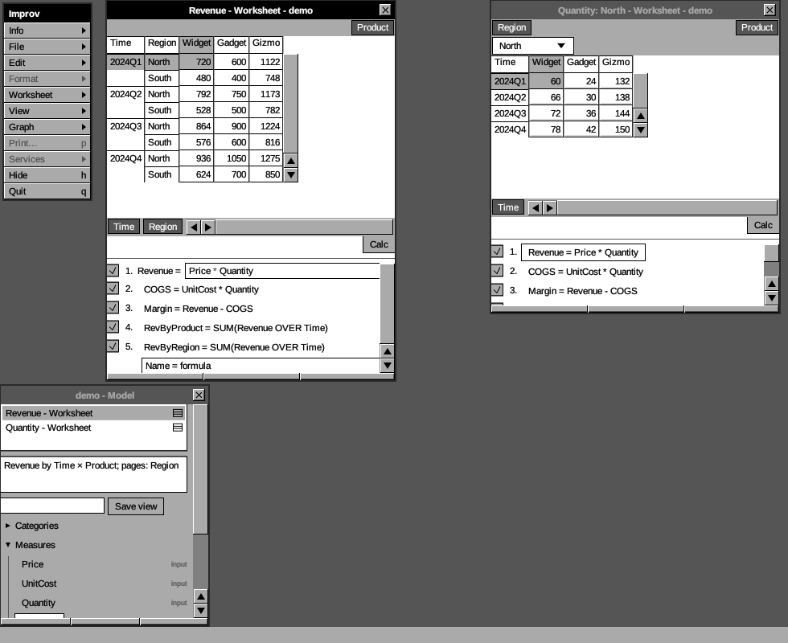

# Improv

A **multidimensional spreadsheet** in Rust, in the line of Lotus Improv and
Quantrix. You model in named **categories**, **items** and **measures**
instead of cell addresses, write formulas over dimensions (with the
spreadsheet functions people know, Excel's names: `IF`, `ROUND`, `NPV`,
`STDEV`, `TEXT` and some 330 more, plus running totals and `PREV`), and
every derived value recomputes **incrementally** through a
differential-dataflow graph. The
same model opens in a NeXTSTEP-style desktop GUI, a terminal UI, a CLI, a
streaming pipe, an HTTP server, and **inside Postgres**.

[](https://gburd.github.io/improv/)
[](https://github.com/gburd/improv/actions/workflows/ci.yml)

**Documentation:** [the Improv guide on GitHub Pages](https://gburd.github.io/improv/)
(also on [Codeberg Pages](https://gregburd.codeberg.page/improv/)) ·
[API reference (rustdoc)](https://gburd.github.io/improv/api/) ·
[Ways to use Improv](https://gburd.github.io/improv/ways.html) ·
[Function reference](https://gburd.github.io/improv/functions.html) ·
[Improv in Postgres](https://gburd.github.io/improv/postgres.html)



```text
Revenue[Time, Product] = Price[Product] * Quantity[Time, Product]
Total[Product]         = SUM(Revenue OVER Time)
```

`Price` is broadcast over `Time`. Editing one Quantity cell recomputes one
Revenue cell and one Total, not the sheet.

## Ways to use it

| | Use it for | Start with |
| --- | --- | --- |
| **GUI** `improv-gui` | building and exploring a model by hand: drag tiles to pivot, edit cells, add formulas, several worksheets at once | `improv-gui sample.db` |
| **TUI** `improv-tui` | the same in a terminal or over SSH | `improv-tui sample.db` |
| **CLI** `improv` | scripting a model, bulk CSV/SQL import and export, CI | `improv --help`, `man improv` |
| **Streaming** `improv stream` | pushing a live feed through a model and reading the changed results | `producer \| improv stream m.db Revenue` |
| **Postgres** `pg_improv` | modeling data already in Postgres; results land in tables any SQL client reads | `CREATE EXTENSION pg_improv` |
| **SQL functions** `LANGUAGE improv` | writing a SQL function as a formula | `CREATE FUNCTION … LANGUAGE improv` |
| **Server** `improv-server` | serving a model to other programs as JSON over HTTP | `improv-server sample.db` |

Each front end takes a model file or a Postgres model URL
(`postgres://user@host/db?model=plan`). The guide's
[Ways to Use Improv](docs/src/ways.md) chapter explains when to use which.

### The desktop GUI


### The terminal UI


### Improv in Postgres


## Install

Pre-built CLI, TUI, GUI and server binaries for Linux, macOS and Windows are
attached to each [release](https://github.com/gburd/improv/releases). To
build from source you need Rust **1.97** or newer:

```sh
git clone https://codeberg.org/gregburd/improv && cd improv
cargo build --release      # target/release/{improv,improv-tui,improv-gui,improv-server}
```

The GUI needs the usual Wayland/X11/OpenGL runtime libraries
(`libxkbcommon-x11-0 libgl1 libegl1` on Debian/Ubuntu). With
[Nix](https://nixos.org), `nix develop` provides the toolchain, those
libraries and the dev tools. External functions need `python3` and, on
Linux, `bubblewrap` for the sandbox.

The Postgres extension is built separately with `cargo-pgrx`; see
[`crates/pg_improv/README.md`](crates/pg_improv/README.md).

## Quick start

Build the 3-D sample model (Time × Product × Region, with Price, UnitCost,
Quantity, Revenue, COGS and Margin) and open it:

```sh
IMPROV=target/release/improv bash docs/demo/sample-model.sh sample.db
target/release/improv-gui sample.db     # or improv-tui sample.db
```

Or build a model by hand with the CLI:

```sh
improv init m.db
improv add-category m.db 1 Time;    improv add-item m.db 10 1 Q1
improv add-category m.db 2 Product; improv add-item m.db 20 2 Widget
improv add-measure m.db 100 Price    number input Product
improv add-measure m.db 101 Quantity number input Time Product
improv set m.db 100 10  --at Product=Widget
improv set m.db 101 100 --at Time=Q1,Product=Widget
improv define m.db 102 "Revenue = Price * Quantity"
improv eval m.db 102
# Revenue[Time=Q1, Product=Widget] = 1000
```

and stream new data through it:

```sh
printf 'Price 15 Product=Widget\n' | improv stream m.db Revenue
# Revenue Time=Q1, Product=Widget = 1500
```

The CLI also imports and exports CSV and SQLite, runs sandboxed Python
functions (`register-ext`, then `CALL(...)`), and refreshes external
measures on a schedule. [Getting Started](docs/src/getting-started.md) is the tutorial;
[`docs/man/improv.1`](docs/man/improv.1) lists every command.

## In Postgres

```sql
-- postgresql.conf: shared_preload_libraries = 'pg_improv', wal_level = logical
CREATE EXTENSION pg_improv;
SELECT improv.create_model('plan');
SELECT improv.bind_category('plan', 'Time',    'sales', 'quarter');
SELECT improv.bind_category('plan', 'Product', 'sales', 'product');
SELECT improv.bind_measure ('plan', 'Price',    'sales', 'price');
SELECT improv.bind_measure ('plan', 'Quantity', 'sales', 'qty');
SELECT improv.define('plan', 'Revenue = Price * Quantity');
SELECT * FROM improv_plan.revenue;    -- kept current as sales changes

CREATE FUNCTION bonus(sales float8, target float8) RETURNS float8
  LANGUAGE improv AS $$ Ratio = sales / target
                        MAX2(Ratio - 1, 0) * 1000 $$;
```

By default a background worker applies committed changes incrementally (at
100k cells, a one-row UPDATE shows up about 50 ms after commit, and the
writer pays nothing). Trigger mode updates the results inside the writer's
transaction, and `improv.recalc()` updates them when you call it.
`improv-gui 'postgres://me@host/sales?model=plan'` opens the same model, and
editing a cell there updates the row in `sales`. See
[Improv in Postgres](docs/src/postgres.md). For a worked example (statement
reconciliation, budgets, net worth and savings goals for a family with jobs,
consulting income, several accounts, cards, crypto, foreign currency, a
house and cars), see [A family's finances in Postgres](docs/src/postgres-finance.md).

## Keys

**TUI:** arrows move · `e`/Enter edit · Tab next measure · `p` pivot ·
`[` `]` page · Shift+arrows select a range (its sum in the status line) ·
`f`/`F` filter · `S` save view · `v` cycle views · `I`/`E` CSV import/export ·
`R` revert to saved · `q` quit and save.

**GUI:** drag a tile between strips to pivot (or right-click it) ·
double-click or Enter to edit · type `Name = formula` on the formula list's
last line · Shift+click or drag selects a range (its Sum in the status bar) ·
Ctrl+S save, Ctrl+Z undo, Ctrl+Y redo · **File ▸ Revert to Saved** after a
save conflict.

## Workspace

| Crate | Binary | What it is |
| --- | --- | --- |
| `improv_core_model` | | Categories, items, measures, coordinates, formulas, values, views |
| `improv_engine` | | Formula compiler and differential-dataflow evaluator; the live incremental engine |
| `improv_nl_formula` | | Controlled-English ⇄ formula |
| `improv_storage_mentat` | | A model as datoms in an embedded [Mentat](https://codeberg.org/gregburd/mentat) (SQLite) store |
| `improv_storage_pg` | | A model in a Postgres `improv` catalog, with columns bound to tables |
| `improv_store` | | Opens a file or a `postgres://` URL |
| `improv_storage_sql`, `improv_storage_csv`, `improv_data_source` | | SQL and CSV import, export and refresh |
| `improv_extfn` | | Sandboxed external functions (Python, R, Julia, Pure, Wasm) |
| `improv_cli` | `improv` | Command-line tool and `stream` |
| `improv_tui` | `improv-tui` | Terminal UI |
| `improv_gui` | `improv-gui` | Desktop GUI (egui) |
| `improv_server` | `improv-server` | JSON HTTP API |
| `improv_pg_model` | | Postgres-free core of the extension |
| `pg_improv` | (extension) | The Postgres extension (pgrx, its own workspace) |

## Development

See [`CONTRIBUTING.md`](CONTRIBUTING.md) for the quality gate (fmt, clippy
with `-D warnings`, tests, `cargo deny`, typos, rustdoc, the GUI screenshot
golden and the ≥ 90% per-crate coverage gate). Design notes are in
[`docs/reviews/`](docs/reviews/) and [`.agent/steering/`](.agent/steering/).
The guide's source is [`docs/src/`](docs/src/) (`mdbook build docs`); man
pages are in [`docs/man/`](docs/man/).

## License

Licensed under either of [Apache-2.0](LICENSE-APACHE) or [MIT](LICENSE-MIT) at
your option.
