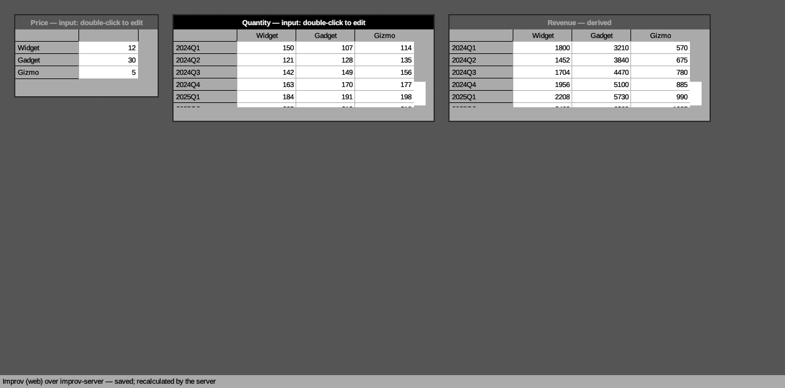

# A web GUI for Improv (road-to-1.0 I1)

**Decision: (a), egui on the web, with the engine and the store in
`improv-server`. Build it after 1.0 as I2, not as a 1.0 requirement.** For
1.0 Improv ships (c): no web GUI, and the `/v1` HTTP API documented for
others to build on. The prototype below shows that (a) works. It also shows
that the work left for I2 is server work (an API a GUI can drive, live
change notification, static hosting) more than GUI work.

Measured on 2026-10-22 against `main` at 4390cc9 (0.11.0 development),
egui/eframe 0.29.1, Rust 1.98, Chromium 155 headless.

## What compiles for the browser

`cargo check --target wasm32-unknown-unknown`, crate by crate:

| crate | wasm32 | what blocks it |
| --- | --- | --- |
| `improv_core_model` | **builds** | |
| `improv_engine` (timely 0.13, differential 0.13) | **builds, does not run** | timely's `Worker::new` calls `std::time::Instant::now`, which panics on wasm32-unknown-unknown (`time not implemented on this platform`; the spike's `?probe` page shows it). The live `Engine` also spawns a worker thread (`std::thread::spawn` in `session.rs`), and the browser has none without `SharedArrayBuffer`, cross-origin isolation and a wasm threads build. |
| `improv_nl_formula`, `improv_extfn`, `improv_storage_csv` | **build** | none of them can open a file in a browser, though: CSV import needs a file picker that hands over bytes |
| `improv_storage_mentat` | **fails** | `mentatdb` needs `uuid` randomness and `tokio` with `mio` (`This wasm target is unsupported by mio`); under it, rusqlite's bundled SQLite in C |
| `improv_storage_pg`, so `improv_store` | **fails** | `postgres` and `tokio-postgres` need `mio` sockets; a browser has no TCP |
| `improv_gui` | **fails** | through `improv_store` |

The engine could be made to run: a patched timely that takes its clock from
`web-time`, and `Engine` reworked to step the dataflow on the calling thread
instead of a worker. That is a fork of a dependency the engine steering
calls delicate (`AGENT_ENGINE_STEERING.md` §2), and it buys little. In the
browser there would be no store to load from, so the model still comes over
HTTP. The browser would also have to hold the whole model in memory, which
rules out the 2.5M-row Postgres models. **What runs where:** the engine and
the store stay in `improv-server`, and the browser only draws.

## How much of `crates/gui` assumes a local store and engine

`crates/gui/src` is 17,828 lines. `app.rs` is 12,927 of them, of which
5,324 are code and the rest tests. Of the 177 functions in `app.rs`'s code:

- **12 touch the engine** (`self.engine`, `Snapshot`, `Engine::new`,
  `rebuild_engine`, `publish`): building it, applying an edit, reading a
  derived cell, and the undo stack, which is whole `Model` snapshots plus
  engine rebuilds;
- **10 touch the store or the path** (`Store::open` in `load`, `save` and
  `revert_to_saved`; `self.db` for the title and the save gating);
- the other ~155 are layout, the grid, tiles, the formula editor, menus,
  the chart, and dialogs.

The modules beside `app.rs` need no engine or store: `theme`, `nxwin`,
`menu`, `diagnostics`, `function_help`, `formula_highlight`. `completion`
takes one helper from `app`; `chart` is an `impl ImprovApp` block that reads
the engine's snapshot; `csv_wizard` reads files through
`improv_storage_csv`. The GUI needs no threads, uses
`SystemTime` only in tests, and has no native file dialog (`rfd` is not a
dependency); its paths are typed in.

So the GUI does not need a rewrite for the web. It needs one seam: the
engine-and-store calls go behind a "model service" trait, with a local
implementation (today's code) and an HTTP one. The ~22 functions above
are the work. The rest of the GUI, the formula editor's located errors,
autocomplete and function help included, are pure functions of the
`Model`, so they work in the browser as soon as the model JSON arrives.

## The prototype

Branch **`work/web-spike`**, crate **`crates/gui_web`**: its own Cargo
workspace (`[workspace]` in its `Cargo.toml`), not a member of the root.
`cargo build --workspace`, the root `Cargo.lock` and CI are untouched
(checked: 17 workspace members before and after, root lock unchanged).

- 594 new lines (`app.rs` 434, `lib.rs` 92, `net.rs` 68). It reuses
  `crates/gui/src/theme.rs` and `nxwin.rs` unchanged through `#[path]`:
  the NeXT four-gray palette, Arimo, title bars and window frames.
- eframe 0.29 with `glow` (WebGL) and no other default features;
  `wasm-bindgen` 0.2.127; requests over `fetch` (`web-sys`).
- It opens the server's model with one worksheet window per measure, rows ×
  columns, extra categories paged. It scrolls. Double-click edits an input
  cell, and Enter sends `POST /measures/:id/cells`. It then re-reads every
  measure, so derived cells show the server's recalculation.
- **Size:** 4.3 MB of wasm in release (1.9 MB gzipped; `wasm-opt -Oz` takes
  it to 3.7 MB, 1.8 MB gzipped). With the engine linked in (`--features
  probe`, debug build) it is 139 MB, another reason to keep the engine
  server-side.

**It runs.** `crates/gui_web/e2e.sh` builds a Time × Product model with the
CLI, serves it with `improv-server`, and drives the page in headless
Chromium over the DevTools protocol (`drive.py`). It loads in 0.7 s and
scrolls Revenue to its last row (2025Q4 = 2964). It double-clicks
Quantity[2024Q1, Widget], types 150 and presses Enter. Revenue[2024Q1,
Widget] goes from 1200 to 1800 (Price 12 × 150), and `improv show`
confirms the store holds 150. The page publishes its visible cells on
`<body data-cells>`, which is how a test reads a canvas.

What the spike leaves out, all I2: pivoting, the formula list and editor,
the menus, undo, views, more than the first page item, and a
`--headless`-free run in a real browser profile.

## The options

### (a) egui on the web, engine in the server

- **For:** one GUI codebase, and the look is already there. The spike
  draws with the desktop's own theme and chrome files. Formula diagnostics,
  autocomplete and function help are `Model`-only code and come along
  free. The golden screenshot test (`scripts/gui-shot-check.sh`) has a
  browser twin in `e2e.sh`.
- **Against:** a canvas app, not a document. Browser find, text
  selection, translation and zoom act on pixels, and URLs can't address a
  cell. **Accessibility is the serious one:** eframe 0.29's web runner drops
  AccessKit updates (`accesskit_update: _, // not currently implemented`
  in `web/app_runner.rs`), and so does the newest eframe, 0.37.0 (checked
  in its source). A screen reader gets only the optional
  `web_screen_reader` speech synthesis, which is not a screen-reader API.
  H2 would fail in the browser until egui grows web AccessKit, or until
  Improv adds a hidden DOM mirror of the grid. Text input goes through
  egui's hidden `<input>` agent. IME and mobile keyboards work, with
  quirks.
- **Effort:** I2 is **L** (4–6 weeks): the model-service seam in
  `crates/gui` (2 weeks), the server endpoints below (1–2 weeks), static
  hosting, the browser golden, and an accessibility workaround (1–2 weeks,
  or accept the gap).

### (b) A separate TypeScript app over the JSON API

- **For:** a native web feel, DOM accessibility (ARIA grid), and grid
  components (AG Grid, Glide) that handle 1M rows with virtual scrolling.
- **Against:** a second UI codebase. It re-implements the pivot tiles, the
  formula editor's located errors, autocomplete and function help in
  TypeScript. The parser's diagnostics and the function catalog would have
  to be served by the server or compiled to wasm (core_model does compile).
  Every desktop feature lands twice, and the NeXTSTEP look is gone unless
  rebuilt in CSS.
- **Effort:** **L+** (8–12 weeks to the parity I2 asks for), then double
  maintenance.

### (c) No web GUI for 1.0

- **For:** 1.0's real risks are elsewhere (B, C, D, J), and the
  server-side prerequisites below are needed by any web GUI anyway. The
  `/v1` API (J1, the server agent's work) is what a third party builds on.
- **Against:** "Improv in a browser" waits for 1.x.
- **Effort:** none beyond `/v1` and its OpenAPI document, already planned.

## What any web GUI needs from the server

These come first whichever option is built:

- **An API a GUI can drive.** Today's API sets an input cell (numbers only)
  and evaluates. A GUI also needs to define and edit a formula (with the
  located error as JSON: offset, message, hint), add and rename
  categories, items and measures, save and open views, and read a
  measure's cells for one page and a scrolled window of rows, not the
  whole cube. `GET /model` is serde's dump of `improv_core_model::Model`,
  internal ids and `Expr` trees included. A GUI that parses it ties
  itself to the J2 internals, and the `/v1` promise must not cover that
  shape (told to the server agent).
- **Auth (C4).** The spike sends `Authorization: Bearer` from `#token=…`.
  A real deployment wants a login that sets an `HttpOnly` cookie, or a
  token the operator hands out, plus the read-only scope (already there:
  `IMPROV_API_TOKENS_RO`), which maps to a read-only worksheet. No token
  in `localStorage`. TLS stays with a proxy, as `server.md` will say.
- **Hosting.** `improv-server` should serve the built `index.html`, `.js`
  and `.wasm` itself (`tower-http`'s `ServeDir`, or `include_bytes!` for a
  single binary). That keeps the page same-origin with the API, so no CORS,
  and the cookie works. The spike's `serve.py` stands in for that.
- **Multi-user conflicts.** The store refuses a save when another writer
  has moved its high-water mark (Mentat's `loaded_tx` check; Postgres's
  `improv.model_version`). The server maps that refusal to 409. But the
  server also caches the model and only sees another writer's change when
  its own write is refused (verified, plan row H9). So two browser users
  share one server-side model, and each write lands in turn. A user who
  writes after another sees their own edit, but the other user's view
  goes stale until they re-read. A web GUI needs change notification: a
  `tx` on every response and a `GET /v1/changes?since=tx` long poll, or
  Server-Sent Events. Per-user undo, presence and merges beyond "last
  write per cell wins, structure changes conflict" are I3, **after 1.0**.
- **Offline.** None, with the engine in the server. A browser cache of
  the model could show the last state read-only. Real offline editing
  would need the engine and a store in the browser (the timely fork above
  plus an IndexedDB store, and a merge on reconnect). Not planned.

## Decision and plan changes

- **1.0:** (c). I2 and I3 move to "Not planned for 1.0" with this reason:
  the GUI side is shown to work (the spike), and what is left is server
  API and multi-user design that 1.0 does not need. `/v1` plus its OpenAPI
  document is the 1.0 deliverable.
- **After 1.0:** I2 is (a), in this order: the server endpoints and change
  feed, static hosting, the model-service seam in `crates/gui`, then the
  browser build of the real GUI (not this spike) with `e2e.sh` as its golden
  test. Before I2 starts, check egui's web AccessKit again. If it is still
  missing, I2 includes a DOM mirror of the visible grid for screen readers,
  or the web GUI ships labeled as not screen-reader accessible.
- **H9** (the server sees other writers' changes) stays a 1.0 task: the
  HTTP API is stale without it, web GUI or not.
