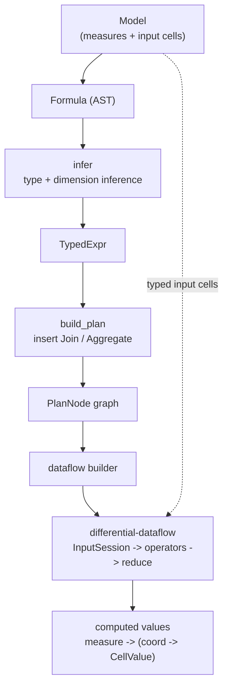

# Architecture & Design

Improv is a small Cargo workspace. Each crate has one job and depends only on
the ones below it.

## Crate layout

| Crate | Package | Purpose |
|-------|---------|---------|
| `core_model` | `improv_core_model` | Categories, items, measures, coordinates, formulas, values, and the formula text parser. No GUI or storage code. |
| `engine` | `improv_engine` | Formula compiler and differential-dataflow evaluation: one-shot `evaluate` and the live `session::Engine`. |
| `verified` | `improv_verified` | Small integer kernels the engine calls, with Verus specifications and machine-checked proofs (see [Formal verification](#formal-verification)). |
| `nl_formula` | `improv_nl_formula` | Controlled natural language ⇄ formula translation. |
| `storage_mentat` | `improv_storage_mentat` | Model ⇄ datoms in an embedded, SQLite-backed Mentat file. |
| `storage_pg` | `improv_storage_pg` | Model ⇄ the `improv.*` catalog in Postgres, with bound measures read from and written to their fact tables. |
| `store` | `improv_store` | `Store`: one store type over both backends, picked by `Store::open` from the target (path or `postgres://…?model=`). |
| `storage_sql` | `improv_storage_sql` | Import SQL query results into a model, export a measure to a table, refresh. SQLite, PostgreSQL, DuckDB. |
| `storage_csv` | `improv_storage_csv` | Import a CSV/TSV file into a model; export a measure's cells (input or computed) to CSV/TSV. |
| `data_source` | `improv_data_source` | The import bookkeeping shared by `storage_sql` and `storage_csv`: create categories and the measure, intern dimension values as items. |
| `extfn` | `improv_extfn` | External functions. Python, R, Julia and Pure run in a sandboxed subprocess (`bwrap` on Linux); Wasm runs in-process on `wasmi` with fuel and memory limits. |
| `cli` | `improv_cli` | The `improv` command-line tool. |
| `tui` | `improv_tui` | `improv-tui`, a VisiCalc-style terminal pivot grid. |
| `gui` | `improv_gui` | `improv-gui`, the desktop GUI (`egui`/`eframe`). |
| `server` | `improv_server` | `improv-server`, a JSON HTTP API over a model store. |
| `pg_model` | `improv_pg_model` | The Postgres-free core of `pg_improv`: catalog rows → `Model`, bound rows → cells, engine results → SQL. |
| `pg_improv` | `pg_improv` | The Postgres extension (pgrx): Improv models over Postgres tables. A thin shell over SPI and `pg_model`. |

## The computation pipeline

A derived measure's formula is compiled through a typed intermediate form into
an operator plan, which is then built into a differential-dataflow graph and
run. Input cells are fed as data; computed values come back out.



The two compiler passes (`infer`, `build_plan`) live in
`engine::compiler`; the plan node types in `engine::plan`; the dataflow builder
and the one-shot `evaluate` entry point in `engine::dataflow`.

`PlanNode` kinds map onto differential-dataflow operators:

| `PlanNodeKind` | Dataflow operator |
|----------------|-------------------|
| `InputMeasure` | an `InputSession` collection (or an already built derived measure) |
| `Literal`      | a one-cell collection at the empty coordinate; as a `MapBinary` operand it is folded into the `map` closure instead |
| `MapUnary`     | `map` |
| `MapBinary`    | `join` on the shared categories, then `map` element-wise |
| `Join`         | re-key both sides to shared categories, `join`, rebuild the union key |
| `Aggregate`    | re-key to the group-by coordinate, then `reduce` (SUM/AVG/MIN/MAX) |
| `FuncCall`     | a scalar function (ABS, ROUND, …): `map` for one argument, `join` then `map` for two |

A final `reduce` collapses each key to a single value before results are
captured. Derived measures are built in dependency order, so one derived
measure can feed another; a cycle is rejected.

## Why differential dataflow

Differential dataflow is a hard requirement of the design: the engine computes
incrementally, so an edit propagates as a **delta** and only the affected cells
recompute. The engine's spike (`dd_revenue_is_incremental`) proves this: after
computing `Revenue = Price * Quantity`, it changes one `Quantity` cell and
confirms the matching `Revenue` cell updates while an unaffected cell does not
recompute.

The version pin is deliberate and delicate — `differential-dataflow =
"=0.13.0"` with `timely = "=0.13.0"`. Newer DD pulls a timely line that does
not compile on the project's rustc; an older DD compiles but aborts on a
`merge_batcher` bug under debug assertions. `0.13.0` is the pair that both
compiles and runs. Do not bump it without re-validating.

## The live engine

`evaluate` runs a model once and returns. Interactive users need more: change
one cell and see what it affects, without a rebuild. That is
`engine::session::Engine`.

`Engine::new(model, targets)` compiles the plans for the target derived
measures, then starts a dataflow on its own thread (timely's
`execute_directly`, one worker). Every input measure gets an `InputSession`.
The model's input cells are fed in at time 0. `new` returns the handle and
the first `Snapshot`.

After that the engine is fed edits:

```rust
pub struct Edit {
    pub measure: MeasureId,
    pub coord: CoordKey,
    pub value: Option<CellValue>, // None removes the cell
}
```

`apply(edits)` sends a batch over a channel. The worker retracts each cell's
old value, inserts the new one, advances time by one, and steps the dataflow
until the probe passes that time. Only the deltas flow, so only the affected
cells recompute. `set` and `clear` are one-edit shortcuts. The reply is the
new `Snapshot`. `apply_delta(edits)` applies a batch the same way but replies
with what the round changed: per measure, each changed cell's coordinate, old
value and new value (`Changes`). `snapshot()` returns the current snapshot.

A `Snapshot` is `Arc<HashMap<MeasureId, Arc<MeasureValues>>>`, where
`MeasureValues` is `HashMap<CoordKey, CellValue>`. It is copy-on-write:
cloning one is a reference-count bump, and measures an edit did not change are
shared with the previous snapshot. A changed measure is copied whole only
while a caller still holds the old snapshot (52 ms for one edit at 1M cells,
against 0.1 ms without), so a caller that keeps a view drops its snapshot
before the next edit, or keeps its own view and applies `apply_delta`'s
changes to it.

The structure is fixed when the engine is built. Changing a formula or adding
a measure means building a new `Engine`. Dropping the handle stops the
thread.

`session::input_cell(type, value)` is the one rule for which model values are
engine cells. A value counts only when it matches its measure's declared type:
`Number`, `Boolean`, `Text` or `DateTime`. Text in a number measure, or an
error value, is no cell. `Engine::new` uses it to pick the seed cells, and the
GUI uses it to turn a cell edit into an `Edit`, so an edit and a rebuild
agree.

Users of the live engine:

| User | How |
|------|-----|
| TUI (`improv-tui`) | one engine per session; a numeric edit is `Engine::set`, any other value rebuilds the engine |
| GUI (`improv-gui`) | one engine per session; edits go through `input_cell` and `apply`, its snapshot dropped first; rebuilt on structural changes |
| `improv stream` | edits read from stdin, changed cells written to stdout |
| server `POST /measures/:id/eval` | a short-lived engine per request, for what-if edits |
| pg_improv's logical worker | one engine per model in `logical` mode, fed the row changes of each batch through `apply_delta`; it writes the changed rows |

## The coordinate / value encoding for dataflow

Timely 0.13 needs dataflow data to be `Clone + 'static`, and data that crosses
an exchange channel to also be `Send + Sync` and serde
`Serialize + Deserialize`. Differential dataflow adds `Ord + Debug`, and keys
must be hashable. The model's `Coordinate` is a dynamic-arity `BTreeMap` and
`Value` holds an `f64`, which is neither `Ord` nor `Hash`. The engine encodes
at the dataflow boundary:

- **Key** — a coordinate becomes a sorted list of `(category_id, item_id)`
  pairs (`CoordKey`, a `SmallVec<[(u32, u32); 3]>`: up to three pairs inline,
  no heap allocation per cell). The `BTreeMap` already iterates
  in sorted order, so the encoding is deterministic and `Ord + Hash`.
  `encode_coord` / `decode_coord` convert at the edge; `project_key` narrows a
  key to a subset of categories (used for joins and group-bys).
- **Value** — the `CellValue` enum:

  | Variant | Holds |
  |---------|-------|
  | `Num(u64)` | an `f64` as `f64::to_bits()`; decoded with `f64::from_bits` |
  | `Bool(bool)` | a boolean |
  | `Text(String)` | text |
  | `Date(i64)` | a UTC timestamp, milliseconds since the Unix epoch |
  | `Err(u8)` | an error, by kind, so errors propagate through operators |

  `CellValue::from_model_value` converts a model `Value`; `Enum` becomes a
  `Num`. Arithmetic happens after decoding, inside `map` and `reduce`
  closures.
- **Diff** — the differential multiplicity `R` stays `isize`.

This encoding is what cleared the project's Phase 1 viability gate.

## Stores and front ends

Every front end opens a model through `improv_store::Store::open`. A path
opens a Mentat file; a `postgres://…?model=<name>` URL opens that model in
Postgres. Both backends have the same methods and the same conflict error, so
the GUI, TUI, CLI and server work on either without knowing which. See
[Storage & Persistence](./storage.md).

`pg_improv` runs the same engine inside Postgres. A model's categories and
measures are **bound** to columns of ordinary tables, and each derived measure
is written to a **result table** (`improv_<model>.<measure>`) that any SQL
client can read. Three sync modes keep the results current: `logical` (the
default; a background worker follows the commit through logical decoding),
`trigger` (statement triggers recompute inside the writer's transaction), and
`manual` (results change when you call `improv.recalc`). See
[Improv in Postgres](./postgres.md).

## Determinism

The core engine is deterministic and unit/property tested. The `Time × Product`
revenue model (with results 1000 / 1000 / 1200 / 1600) is the canonical fixture
checked by `engine`'s tests, and each crate carries its own test module.

## Formal verification

A few integer kernels of the engine are proven correct with
[Verus](https://github.com/verus-lang/verus), not just tested. They live in
`crates/verified` inside `verus! { ... }` blocks: a `spec fn` states what the
kernel means and the executable function `ensures` it. Under plain cargo the
specs are erased, and the engine calls these functions, so the proven code is
the code that runs. `scripts/verify.sh` (and a CI job) checks the proofs with
the pinned Verus release.

What is proven:

| Kernel | Used by | Proven |
|--------|---------|--------|
| `gcd::gcd` | `GCD`, `LCM`, the number-theory functions | The result is Euclid's gcd: it divides both arguments, every common divisor divides it, and `gcd(a, 0) = a`. |
| `gcd::lcm_below` | `LCM` | The result is a positive common multiple, `a / gcd(a, b) · b`; it is `None` exactly when that reaches the cap (2⁵³), so the overflow check neither misses nor over-rejects. |
| `radix::encode` / `decode` | `DEC2BIN`, `BIN2DEC`, … (radix 2, 8, 16) | `decode(encode(v)) = v` for every `v` in [−r¹⁰/2, r¹⁰/2); `encode` is `None` exactly outside that range; its digits are each below the radix, at most 10, and 10 for a negative `v`. `decode` rejects more than 10 digits or a digit not below the radix, and otherwise means exactly 10-digit two's complement. |
| `radix::to_digits` | `BASE`, and the above | The digits (radix 2–36) are each below the radix, have no leading zero, and are worth exactly the input. |
| `bits::and` / `or` / `xor` / `shl` / `shr` | `BITAND`, `BITOR`, `BITXOR`, `BITLSHIFT`, `BITRSHIFT` | For operands below 2⁴⁸: every result stays below 2⁴⁸; `and` is at most either operand, `or` at least; `shl` is exactly `x · 2ⁿ` (below 2¹⁰¹, no overflow) and `shr` exactly `⌊x / 2ⁿ⌋` for shifts up to 53. |
| `graph::build_order` | the derived-measure build order (`derived_build_order`) | The depth-first post-order from the targets holds exactly the measures reachable from them, each once and after every measure it depends on; it fails exactly when a dependency cycle is reachable. So building a model's dataflow always terminates, and a cyclic model is always rejected. |
| `take::range` | `TAKE`, `DROP` | The kept index range is in bounds (`from ≤ to ≤ len`) and holds `m` values for `TAKE`, `len − m` for `DROP`; `TAKE` and `DROP` of one count partition the list. |
| `keys::project` | every join key and group-by (`project_key`) | Exactly the pairs whose category is kept, in their order; a sorted key projects to a sorted key. |
| `keys::union_keys` | every dimensional join | A merge of two sorted keys: sorted with no category twice, contains every pair of both when they agree on shared categories, and nothing else. |

What is tested instead: everything with floating point. Verus does not reason
about `f64` arithmetic, so the kernels take and return integers and the engine
does the float range checks and truncation before calling them. The numeric
functions are checked against LibreOffice and Gnumeric goldens
(`crates/engine/tests/data`), and invariants (parse ⇄ print, save ⇄ load,
key encoding) by property tests.
