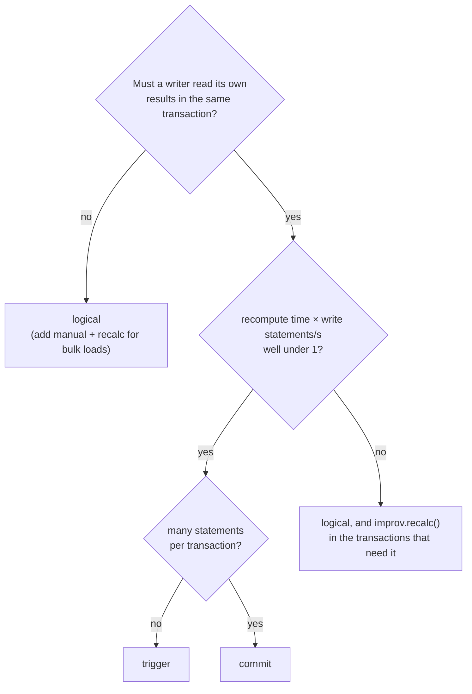

# Capacity Planning

This page turns measured costs into sizing formulas. It is for whoever
decides how much memory a Postgres server or a desktop needs for a model,
which sync mode to use, and how much disk a stopped worker can fill.

Every number links to where it was measured:

- **[bench]**: the [v0.10.0 scale benchmark][bench] (EC2 c7i.8xlarge,
  16 cores, release builds).
- **[changelog]**: the post-0.10.0 fixes in the [CHANGELOG][changelog]'s
  Unreleased section, with before/after numbers in their commit messages.
- **[here]**: re-measured on `main` (pg_improv 0.11.0) for this page, on
  the same instance type. See [Measurements for this page](#measurements-for-this-page).

Where `main` changed a cost, the post-fix number is used. These are
measurements of particular models. Treat a formula as an estimate within a
factor of about two, and measure your own model before you buy hardware.

## The costs

| Cost | Value | Source |
| --- | --- | --- |
| Engine memory per cell | about 0.3 kB in the live engine (5M-cell `Price * Quantity` grid: 269 B per cell); `evaluate` with its model about 0.5 kB (1M cells: 0.54 GB peak; 5M: 2.35 GB); 20k measures × 100 items: 1.17 GB | [changelog] (B7: no collapse after a join) |
| Engine evaluate | about 0.9 µs per cell on one worker (1M cells 0.87 s, 5M 4.5 s); 0.22 µs on 8 (1M cells 0.22 s, 2M 0.45 s), using 15–20 % more memory | [changelog] (B7, `evaluate` on several workers) |
| One-cell edit | 56 µs at 100k cells, independent of size; plus a per-measure round cost (fan of 20k measures: 129 ms per edit) | [changelog] |
| Logical worker memory, fold state per fact row, `count` + `count_distinct` bindings | about 120 B (derived: 444 MB private for 2.5M rows, less the engine's 4 × 44,750 cells at 0.8 kB) | [bench] §1, [here] |
| Logical worker memory per small model | about 0.6 MB (1,000 models of 1,000 rows: 575–602 MB) | [here] |
| FIXPOINT memory per edge | about 0.4 kB in the live engine (10M edges: 390 B per edge, 8.2 GB peak); the tagged 1.5k and 10k-node tests together peak at 1.5 GB | [changelog] (B8), [qual] |
| Worker CPU per 1,000-row batch | about 20–25 ms above idle | [here] |
| Worker idle CPU | 0.08 core at `poll_ms = 50` with one large model; 0.06 core at 200 models, 0.11 at 1,000 | [here] |
| Initial build (or rebuild) per million fact rows | about 2.1–2.6 s (2.5M rows: 5.3–6.5 s) | [here] |
| `improv.recalc` per million fact rows | about 0.9–1.1 s (2.5M rows: 2.2–2.8 s) | [here] |
| Logical apply latency, 1,000-row batch | 86–130 ms commit → visible at `poll_ms = 50` (at the default 200, add up to a poll) | [bench] §1, [here] |
| Trigger mode, per write statement, 2.5M-row model | 380–390 ms for 1,000 rows; 3.1 s for 10 one-row statements in one transaction | [bench] §3e, [here] |
| Commit mode, per transaction, 2.5M-row model | 2.2 s | [changelog], [here] |
| `improv.what_if`, one cell, element-wise chain | 0.28 s on 2.5M rows | [changelog], [here] |
| WAL per bound-table row (2.5M-row table, `REPLICA IDENTITY FULL`) | INSERT 190–230 B, UPDATE 240–700 B, DELETE about 360 B | [here] |
| Store file (Mentat) on disk | about 1.2 kB per input cell (100k cells: 120 MB; 1M: 1.2 GB) | [bench] §3g, [qual] |
| Store file import (`import-csv`) | linear: 1M rows in 74–78 s, 585 MB peak | [qual] |
| DuckDB `improv()` | 2.5M fact rows folded to 44,750 cells: 0.3–0.35 s, 500–640 MB (more with more DuckDB threads); 2.5M *distinct* cells: 4.1 s, 1.7 GB | [qual] |

## Memory

**A model in the GUI, TUI, CLI or server** holds every cell in the engine:

```text
RAM ≈ cells × 0.5 kB + store overhead
```

A 1M-cell model needs about 0.5 GB. "Cells" means input cells plus every
derived cell, so a model with ten derived measures over the same grid as
its inputs has about eleven times the input count.

**The logical worker** (one Postgres backend) holds, for each logical-mode
model, its fold state and its live engine:

```text
worker RAM ≈ Σ over models ( fact rows × 120 B  +  cells × 0.8 kB ) + 0.6 MB per model
```

"Cells" counts the model's input and derived cells. The 120 B per row is
derived from one measurement: the worker's 444 MB with a `count` and a
`count_distinct` binding, less its engine cells (the benchmark's
"180 B per fact row" is the total, engine included). `count_distinct` keeps every distinct value per coordinate, and
`min`/`max` keep a count per value, so these grow with the data's
cardinality. `sum`, `avg` and `count` keep a few numbers per coordinate and
cost less (not measured separately). The worker also reads the tables
through shared buffers. That shows up in its RSS as shared memory (about
300 MB in the example) but is not extra memory.

**FIXPOINT** models need about `edges × 0.4 kB` on top, and more at
peak while they build: ten million edges peaked at 8.2 GB.

`improv.max_cells` (default 5,000,000 bound input cells per model) refuses
`recalc`, trigger and commit recomputes and the worker's apply above it.
Raise it only after sizing the memory.

`improv.status` reports what each logical model holds in the worker, as
`fold_bytes` and `engine_bytes`, and `improv.max_model_memory` caps their
sum per model ([monitoring](./monitoring.md#capping-a-models-memory)).
Measured on 0.11.0 (estimate = live heap): a fold state takes 533 B per
coordinate for `count` or a numeric `sum`, 837 B for a float `sum`, and
about 1 kB plus 40–60 B per kept value for `count_distinct`, `min` and
`max`. A model's input cells take about 226 B each, and its engine
120–450 B per cell (input plus derived): a map of an input is the low
end, a join or a reduction the high end.

## CPU and time

```text
initial build / rebuild ≈ 2.1–2.6 s per million fact rows
recalc / commit-mode transaction ≈ 0.9 s per million fact rows of the written tables
logical worker ≈ 20–25 ms CPU per 1,000 changed rows + idle polling
```

The worker is one process. Each model's engine computes on a thread of
its own, so models whose formulas take long compute at the same time, on
as many cores. The decode, the fold of aggregated bindings, and the SPI
writes of the results stay on the worker's one thread. That is the
`20–25 ms per 1,000 changed rows`, and the share every model's batches
take turns on:

```text
worker utilization ≈ (changed rows/s ÷ 1,000) × 25 ms  +  idle cost
```

At 10,000 changed rows per second that is about a quarter of a core.
Engine time is not in it: a model whose apply takes 1 s in its formulas
(a large `MEDIAN`, a `FIXPOINT`) uses 1 s of its own core and delays only
its own results. Beside four such models a fifth model's change was
visible in 40–100 ms [here]. A rebuild still blocks the other models for
its whole duration, since it loads and writes on the worker's thread: a
6 s rebuild delays every other model's results by 6 s. Count your
expected rebuilds (restarts, deploys, new items in categories a formula
reads the item list of) as well as your batches.

## WAL retained while the worker is down

The slot `improv_db` keeps **all** WAL the server writes from its
`restart_lsn` on, not only the bound tables' WAL. So, while the worker is
stopped (or stuck):

```text
retained WAL per hour ≈ server WAL rate (bytes/s) × 3600
```

The server's WAL rate is `pg_stat_wal.wal_bytes` sampled twice, divided by
the interval. Measure it; it is the right number. If you only know the
bound tables' write rate, a lower bound is:

```text
bound-table WAL per hour ≈ rows written/s × WAL per row × 3600
```

The WAL per row was measured on the 2.5M-row example table (rows of about
86 B, `REPLICA IDENTITY FULL`). It was 190–230 B per inserted row, about
360 B per DELETE, and 240 B (single row) to 700 B (bulk, after a
checkpoint) per UPDATE, because `REPLICA IDENTITY FULL` logs the whole old
row. Wider rows cost proportionally more, and full-page images after each
checkpoint add to it.

Example: 1,000 updated rows per second at 700 B is 2.5 GB per hour.
`max_slot_wal_keep_size = 10GB` then gives about four hours before the slot
is lost and every model needs a rebuild. Size `max_slot_wal_keep_size`
for the longest outage you want to survive without a rebuild, and keep the
`pg_wal` volume larger than that. [Monitoring](./monitoring.md) has the
alerts.

## Models per database

- **One logical database per server.** The worker serves the database named
  by `improv.database`. Models in other databases of the same server can
  use `trigger`, `commit` or `manual` mode, but logical-mode models there
  are never applied.
- **Many models in one database.** All logical models share one slot, so
  the decoding cost does not grow with the model count. On `main`, 1,000
  small models built in 0.8 s after their switch to logical mode, a one-row
  change showed up in 54–146 ms, and a transaction writing every model's
  table showed up everywhere within 2.6 s [here]. At v0.10.0, with a slot
  per model, the same took up to 120 s and 201 s ([bench] §3f).
- **The limit is the worker's one thread.** The models' engines compute
  at once, but their decodes, folds, writes and rebuilds run one after
  the other. So a change may wait for the sum of the other models' writes
  and rebuilds, but not for their engine time. Rebuilds and write-heavy
  models in their own processes (background workers per busy model) are
  not built; see B1 in the [road to 1.0][plan].

## Choosing a sync mode by write rate and model size

Trigger and commit modes lock the model's catalog row for the recompute.
Writers to one model's tables therefore take turns, and a mode's cost per
write also caps the write rate:

| Mode | Cost to the writer | Write rate it sustains per model |
| --- | --- | --- |
| `logical` | none | bounded by the worker: about 40,000 changed rows/s of worker time at 25 ms per 1,000 |
| `trigger` | one scoped recompute per **statement**: 0.38 s on the 2.5M-row model; 30–170 ms at 10k cells (pg_improv README benchmarks) | about 1 / cost statements per second: 2–3 statements/s on the example |
| `commit` | one full recompute of the written tables' dependents per **transaction**: 2.2 s on the example; 77–82 ms at 10k cells | about 1 / cost transactions per second: 0.45/s on the example |
| `manual` | none | any; results are as fresh as your last `recalc` |



Rules of thumb:

- **Under about 100k cells and a few writes per second:** any mode works.
  Pick by consistency ([Concepts](./concepts.md#keeping-postgres-results-current-the-sync-modes)).
- **Millions of fact rows, or more than one write per second:** `logical`.
- **Bulk loads and migrations:** switch to `manual`, load, `recalc` once,
  switch back. Leaving `logical` and entering it again costs one rebuild.

## Worked example: 2.5M rows, 44,750 cells

The model from [benchmark §1][bench]: a `contribution_rows` table of
2.5M rows (person, year, release, scope, commit sha), bound as
`agg => 'count'` and `agg => 'count_distinct'` into Person × Year ×
Release × Scope (1,790 × 15 × 4 × 3, 44,750 coordinates), with two derived
measures. Assume writers add 1,000 rows a minute in 1,000-row batches, and
the server writes no other WAL.

| Question | Estimate | Measured on `main` [here] |
| --- | --- | --- |
| Worker memory | 2.5M × 120 B = 300 MB, plus 4 × 44,750 cells (2 input, 2 derived measures) × 0.8 kB = 143 MB: 443 MB (the per-row figure was derived from this model) | 444 MB private (plus 316 MB of shared buffers) |
| Initial build | 2.5 × 2.1–2.6 s = 5–6.5 s | 5.3–6.5 s |
| Rebuild after a restart or `define` | the same | 5.4 s |
| `recalc` | 2.5 × 0.9–1.1 s | 2.2–2.8 s |
| A 1,000-row batch | one or two polls (50 ms in the test; 200 ms by default), plus apply | 86–130 ms commit → visible at `poll_ms = 50` |
| Worker CPU | 1 batch/min × 25 ms: negligible next to idle polling | 0.08 core at `poll_ms = 50`, mostly idle polling |
| WAL retained per hour of downtime | 1,000 rows/min × 230 B × 60 = 14 MB/h from this table, plus all other WAL | (derived) |
| Fits `improv.max_cells`? | 2 × 44,750 bound cells ≪ 5,000,000 | yes |
| Mode | `logical`: trigger would cost 0.38 s per statement, commit 2.2 s per transaction | |

With `max_slot_wal_keep_size = 10GB` this model survives roughly a month
of worker downtime from its own writes alone. The rest of the database's
WAL decides the real number.

## Measurements for this page

Made on 2026-10-21 on EC2 c7i.12xlarge (Intel Xeon, 48 vCPU, 92 GB),
Debian 13, PostgreSQL 18.6 (PGDG release build), pg_improv 0.11.0 built
from `main` with `cargo pgrx install --release`. Nothing else heavy ran on
the box.

- **The 2.5M-row model:** `ROWS=2500000 BATCHES=1000 tests/scale.sh`
  (`crates/pg_improv/tests/`), twice. Load 6.8–7.0 s, `REFRESH
  MATERIALIZED VIEW CONCURRENTLY` 4.9–5.8 s, `recalc` 2.4–2.8 s, initial
  build 5.3–6.5 s, six 1,000-row batches visible in 86–130 ms, no rebuild,
  PASS. Worker RSS sampled every 0.5 s from `/proc/<pid>/status`: 444 MB
  anonymous after the build, flat through the batches.
- **Trigger, commit, `recalc`, `what_if`:** on that model, after the run
  (`KEEP=1`). Trigger mode: 379–387 ms per 1,000-row INSERT statement,
  3,073 ms for 10 one-row INSERT statements in one transaction. Commit mode:
  2,214–2,217 ms per 1,000-row transaction, 2,197 ms for 10 one-row INSERT statements
  in one transaction. `recalc` 2,205–2,223 ms. `what_if` of one cell
  281–285 ms. Back to logical: rebuild in 5.4 s.
- **Worker CPU:** 20 batches of 1,000 rows, 0.5 s apart, cost 1.40 s of
  worker CPU over 12.3 s. Idle cost: 0.77 s per 10 s at `poll_ms = 50`.
  That leaves about 22 ms per batch (1.40 s − 12.3 s × 0.077, over 20).
- **WAL per row:** `pg_current_wal_insert_lsn()` before and after, on the
  same table: one 10,000-row INSERT 189 B/row, UPDATE 699 B/row, DELETE
  355 B/row (each right after a `CHECKPOINT`, so with full-page images); ten
  one-row INSERT transactions 228 B each, ten one-row UPDATE transactions 242 B each.
- **Many models:** the v0.10.0 benchmark's `pg_many.sh` (§3f), unchanged,
  at 200 and 1,000 models. 200: all built 0.6 s after the last switch,
  one-row change visible in 53–292 ms, a transaction touching all 200 in
  0.56 s, worker 121–128 MB private. 1,000: built 0.8 s after the last
  switch, 54–146 ms, all 1,000 in 2.6 s, 575–602 MB private, 1.13 s CPU per
  10 s idle.
- **Re-measured for the 0.12.0 release** (the [qualification][qual]):
  `scale.sh` at 2.5M rows on PG 17 and 18 (`recalc` 2.3–2.5 s, initial
  build 5.5–5.6 s, batches visible in 54–113 ms in three runs of four),
  1,000 models (all built 22 s after the last switch, a one-row change in
  33–124 ms, 322 MB private, 0.12 core idle), FIXPOINT, the engine probes
  (a RANK edit 1.5 ms at 1M items), the 1M-row import and DuckDB.
- **Re-measured for the 0.11.0 release** (the [0.11.0 qualification][qual011]):
  `scale.sh` at 2.5M rows on PG 17 and 18 (`recalc` 2.3–2.5 s, initial
  build 5.4–5.6 s, batches visible in 83–145 ms in four runs of five),
  1,000 models (all built 21 s after the last switch, a one-row change in
  52–182 ms, 426 MB private), FIXPOINT, the engine probes, the 1M-row
  import and DuckDB.
- **Parallel apply (B1),** 2026-10-26, the same box, PG 17.11 (PGDG),
  release build. Four models of 2,000 items, each with
  `F = FIXPOINT(0, LAMBDA(r, X - r), 1451, 0)`, which never converges and
  so runs all its rounds: 1.0–1.06 s of engine time per one-row change.
  A writer kept all four busy, and a fifth model (`W = V * 2`, one row)
  took ten one-row changes. Before B1 each was visible in 5.2–8.3 s
  (median 7.9 s); after, in 40–103 ms (median 57–71 ms), in three runs
  (`tests/logical.sh` §21). In the timings the worker logged before the
  change, the engine was 96–99 % of a slow apply (745–782 ms of a
  767–803 ms apply for a `MEDIAN` over 1M items, and 1.00–1.04 s of
  1.006–1.046 s for the FIXPOINT), and decode, fold and SPI writes were
  under 1 ms. A batch of 20,000 rows that rewrites 20,000 result rows is
  the other way around: 42 ms of decode and fold, 25–32 ms of engine, and
  126–472 ms of SPI writes, which B1 does not overlap.

[bench]: https://codeberg.org/gregburd/improv/src/branch/main/docs/reviews/2026-10-20-v0.10.0-benchmark.md
[changelog]: https://codeberg.org/gregburd/improv/src/branch/main/CHANGELOG.md
[here]: #measurements-for-this-page
[qual]: https://codeberg.org/gregburd/improv/src/branch/main/docs/reviews/2026-10-27-v0.12.0-qualification.md
[qual011]: https://codeberg.org/gregburd/improv/src/branch/main/docs/reviews/2026-10-25-v0.11.0-qualification.md
[plan]: https://codeberg.org/gregburd/improv/src/branch/main/docs/reviews/2026-10-21-road-to-1.0.md
