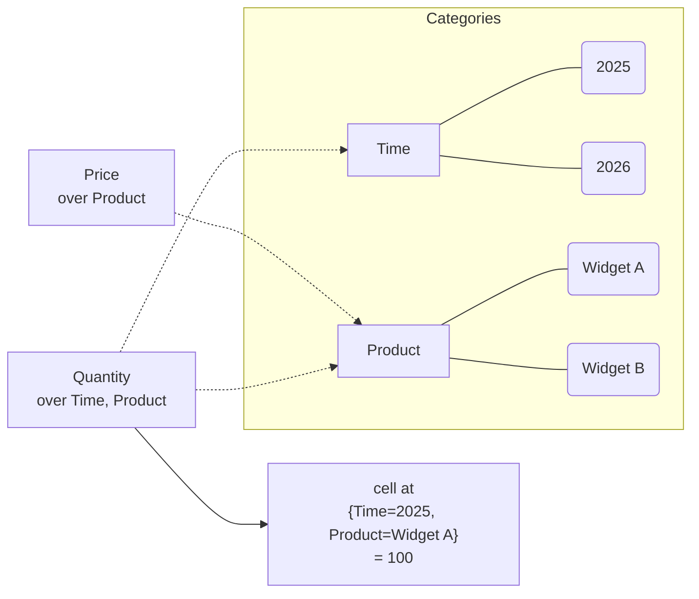
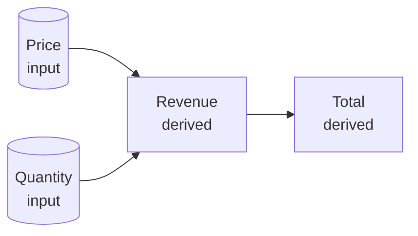
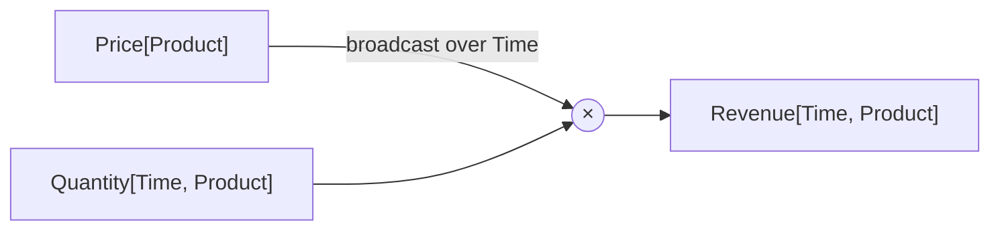
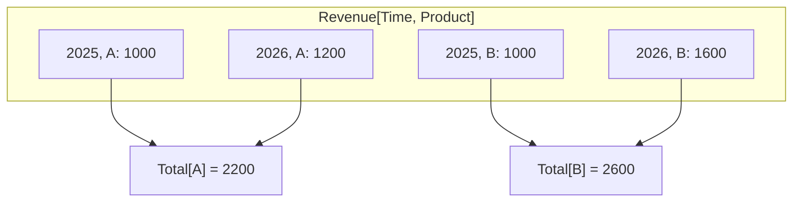
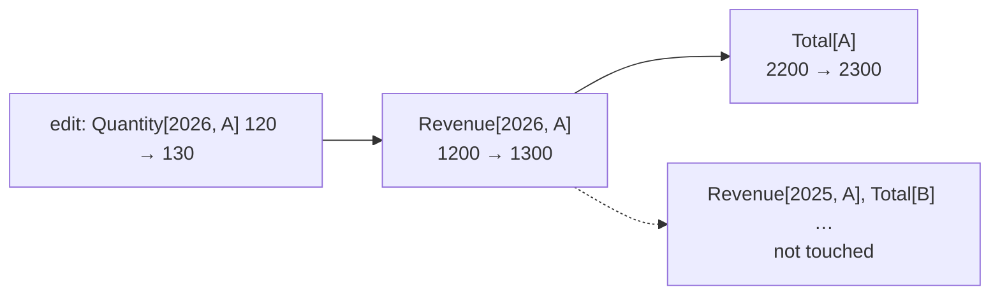
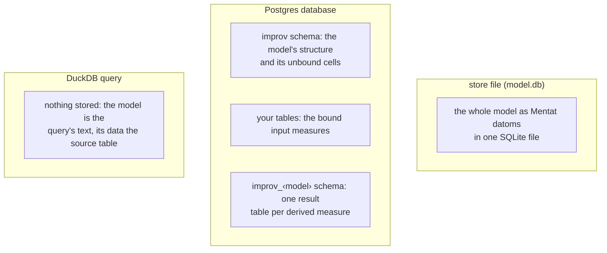
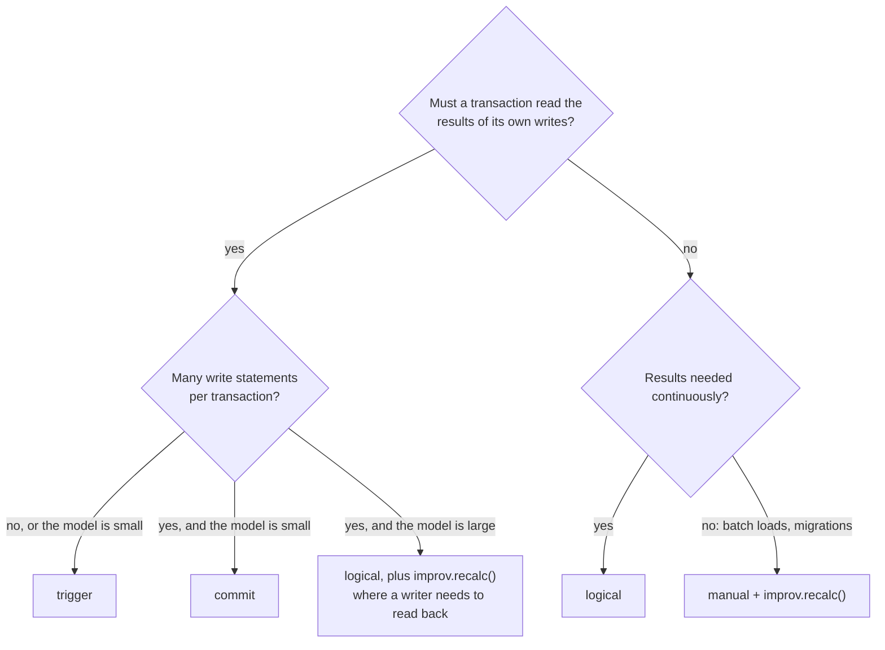

# Concepts

This page is the ideas, before the syntax. Read it once and the rest of the
guide is details: [The Improv Model](./model.md) maps each idea onto the
types, [The Formula Language](./formulas.md) gives the grammar, and
[Ways to Use Improv](./ways.md) picks a front end.

## A model is named dimensions, not a grid

A spreadsheet names a cell by where it sits (`B7`). Improv names it by what
it means: *the Quantity of Widget A in 2025*. A model has four parts.

- A **category** is a dimension: `Time`, `Product`, `Region`.
- An **item** is a member of one category: `2025` and `2026` in `Time`.
- A **measure** is a named variable over some of the categories: `Price`
  over `Product`, `Quantity` over `Time` and `Product`.
- A **coordinate** picks one item from each of a measure's categories:
  `{Time=2025, Product=Widget A}`. A measure's value at a coordinate is a
  **cell**.



A measure has a cell only where a value exists: a model is sparse. Six
categories of 100 items each name 10^12 coordinates, and a model holding a
million of them costs what a million cells cost.

Categories, items and measures carry stable ids; names are labels. Renaming a
category never breaks a formula, and moving a category from the rows to the
columns of a view (pivoting) changes how the cube is shown, not what it
holds.

## Input and derived measures

Every measure is one of two kinds:

- An **input** measure holds data: typed in, imported from CSV or SQL, or
  bound to a column of a Postgres table.
- A **derived** measure holds a formula and nothing else. Its cells are
  computed and are never stored as input.



Data goes in at the inputs; everything else follows. You edit an input cell,
never a derived one (the GUI and the TUI refuse it; hover a derived cell to
see its formula).

## A formula is written once, over categories

```text
Revenue = Price * Quantity
```

This is one formula for every cell of `Revenue`, not one per row. It has no
cell addresses to copy down a column, and adding `2027` to `Time` extends
`Revenue` to 2027 with no edit. A derived measure's categories follow from
its formula: `Quantity` is over `Time` and `Product`, so `Revenue` is too.

When the operands have different categories, the smaller one is
**broadcast**: `Price` is over `Product` only, so every year reuses the same
product's price. Broadcasting needs one operand's categories to be a subset of
the other's. `Price[Product] + Headcount[Region]` has no sensible meaning,
and the compiler refuses it as a dimension mismatch rather than guessing.



## OVER and reductions

A reduction collapses categories. `OVER` names the ones to collapse:

```text
Total = SUM(Revenue OVER Time)      -- Total is over Product
Share = Revenue / SUM(Revenue OVER Product)
```

`SUM(Revenue OVER Time)` adds each product's years together, so `Total` is
over `Product` alone. The second line divides each cell by its year's total
across products: the reduction collapses `Product`, and the division
broadcasts the result back over it. The same `OVER` works with every
reduction: `AVERAGE`, `MIN`, `MAX`, `COUNT`, `MEDIAN`, `RANK`, `TEXTJOIN`
and the rest ([Aggregations](./formulas.md#aggregations)).



Only a reduction removes a category. A plain reference must keep every
category of its measure, so `X = Quantity[Product]` is an error: nothing says
what to do with `Time`.

## Incremental recalculation

The engine turns the formulas into a
[differential dataflow](./architecture.md#why-differential-dataflow) graph.
An edit is a **change** to the inputs: the old value out, the new one in. The
change flows through the graph, and each operator passes on only the part of
its output that changed.



"Only what changed" means: the cells the edit can reach are recomputed, and
nothing else. A single-cell edit on a grid takes the same time at 10k cells
as at 100k (about 60 µs; see the [benchmark](#numbers)). Two costs do not
shrink to the edit:

- **A reduction re-reads its group.** Changing one cell under
  `SUM(X OVER W)` re-reduces the group it falls in. Over more than 1,024
  items, `SUM`, `AVERAGE`, `MIN`, `MAX`, `COUNT` and the other simple
  reductions work in blocks of 1,024 items, so an edit re-reads one block
  plus the block totals. `RANK` and `SORT` re-read the whole group, because
  one new value can move every rank.
- **Each round has a fixed cost per measure.** Every edit is one round of
  the dataflow, and a round visits every tracked measure, reached or not.

Some changes are not edits. They rebuild: the graph is compiled again and
every derived cell recomputed.

- **A change of structure:** a new or redefined formula, a new measure or
  category. The graph's shape is fixed when it is built.
- **A new item in a category that a formula reads the item list of:**
  positions and neighbours (`POSITION`, `PREV`, `NEXT`, recurrences, running
  windows), per-item and list reductions (`RANK`, `SORT`, `INTO`), `FILL`,
  `RELABEL`/`SWAP`, and reductions other than the simple ones above. A new
  item under `SUM`, `AVERAGE`, `MIN`, `MAX`, `COUNT` and the like arrives as
  data and does not rebuild.
- **In Postgres**, also: two rows landing on one coordinate of a measure
  bound without an aggregate, a change to a text `min`/`max` binding, and
  any error. The full list is in
  [the pg_improv README](https://codeberg.org/gregburd/improv/src/branch/main/crates/pg_improv/README.md) (logical mode).

A rebuild costs what loading and computing the model from scratch costs, so
a model that rebuilds on every write gets none of the incremental benefit.
In Postgres, `improv.status(model)` counts the rebuilds.

## Where data lives

The model is the same everywhere; what holds it differs.



- **A store file** is one SQLite file holding everything (Mentat datoms:
  [Storage & Persistence](./storage.md)). The GUI, TUI, CLI and server open
  it by path. It is a file to copy, mail or check in.
- **A Postgres model** keeps its structure in the `improv` schema. Its input
  measures can be **bound** to columns of your own tables, so the data stays
  where it is. With `pg_improv` installed, every derived measure is a table
  in the schema `improv_<model>` that SQL reads like any other
  ([Improv in Postgres](./postgres.md)).
- **DuckDB** stores nothing: `improv(source, model)` reads the source and
  computes the model for each query ([Improv in DuckDB](./duckdb.md)).

## Keeping Postgres results current: the sync modes

When the bound tables change, a Postgres model's results must follow. A
model's **sync mode** says when, and who pays.

| Mode | Results change | The writer pays |
| --- | --- | --- |
| `logical` (default) | shortly after the commit, applied by a background worker | nothing |
| `trigger` | inside the writing statement | a recompute per write statement |
| `commit` | inside the writing transaction, just before `COMMIT` | one recompute per transaction |
| `manual` | when you call `improv.recalc()` | nothing until then |

Pick by the question a writer asks:



`commit` mode reloads every table the transaction wrote in full, so on large
models it costs seconds per commit; `trigger` mode recomputes only the
touched coordinates when the formulas allow it. `logical` mode never slows a
writer, and its results lag the commit by about one worker poll. The
[pg_improv README](https://codeberg.org/gregburd/improv/src/branch/main/crates/pg_improv/README.md#keeping-results-current-trigger-vs-commit-vs-logical-vs-recalc)
has the full comparison.

## Numbers

Timings on this page are from the
[v0.10.0 scale benchmark](https://codeberg.org/gregburd/improv/src/branch/main/docs/reviews/2026-10-20-v0.10.0-benchmark.md)
(EC2 c7i.8xlarge, release builds), and the single-cell edit time from the
CHANGELOG's post-0.10.0 entry for `CoordKey` (56 µs at 100k cells, was 64 µs).
