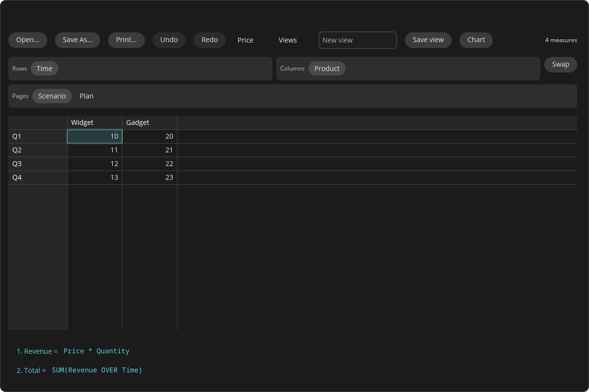
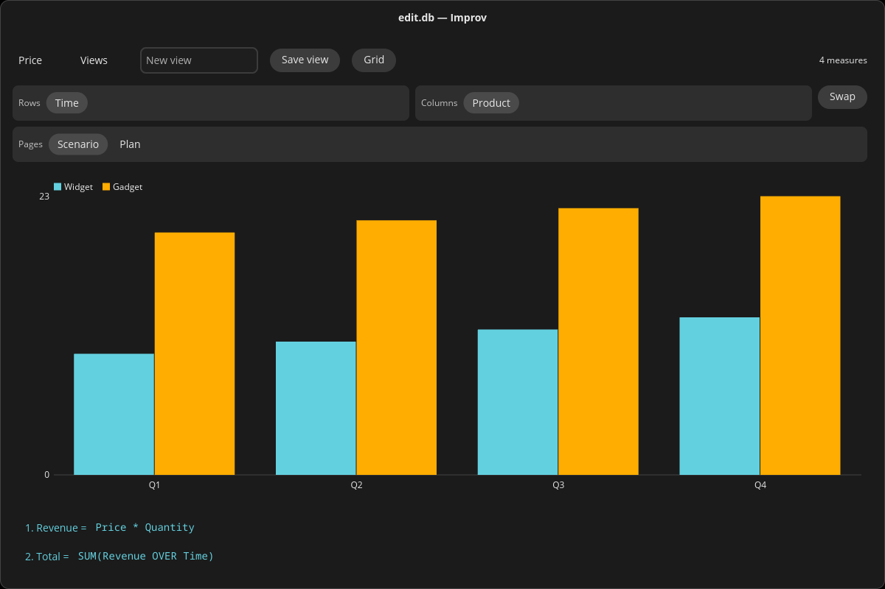

# The COSMIC Desktop GUI

`improv-cosmic` is a second desktop front end, built on
[libcosmic](https://github.com/pop-os/libcosmic), the toolkit the COSMIC
desktop (System76, Pop!_OS) is made of. It is a native COSMIC
application: it takes the desktop's theme, light or dark, and its accent
color, and it opens, saves and prints through the XDG desktop portals.
It works on the same models as [`improv-gui`](./gui-tour.md), the
NeXTSTEP-style workspace, and both stay: pick the one that fits your
desktop.



*The demo model's Price measure in COSMIC's dark theme: the header bar,
the Rows, Columns and Pages strips of category tiles, the grid (the
cursor in the accent color), and the formula list.*

It is a preview. It covers the everyday work on a model (see
[What it does](#what-it-does)), not yet all of `improv-gui`; see
[Not yet](#not-yet).

## Running it

`improv-cosmic` is its own Cargo workspace, `crates/gui_cosmic` (libcosmic
pins its own toolkit stack, apart from the egui GUI's). From a checkout:

```sh
cd crates/gui_cosmic
cargo run --locked --release -- ../../sample.db
cargo run --locked --release -- 'postgres://me@127.0.0.1/sales?model=plan'
```

On Linux the build needs `libxkbcommon-dev` and `libwayland-dev` (Debian
names). It runs on Wayland (COSMIC's own compositor, or any other) and on
X11. `ICED_BACKEND=tiny-skia` selects the software renderer, for a machine
with no GPU backend. Without an argument the model is in memory only.

## What it does

- **The grid.** The shown measure (pick it in the header bar's list) as a
  grid that draws only the cells in view, so a measure of a million cells
  scrolls as fast as a small one. Arrows, Tab, Page Up and Down, Home and End
  move; Ctrl+Home and Ctrl+End go to the first and last cell; Shift extends
  a range.
- **Editing.** Type on a cell, or press Enter or F2, or double-click it, to
  edit it; Enter commits and moves down, Escape cancels, Delete clears. The
  text is read by the measure's value type, as everywhere in Improv: `42` in
  a Text measure is text, and text that is not a number in a Number measure
  is refused with the reason. Derived cells are computed, not entered.
- **Formulas.** Under the grid, every formula in Improv's numbered list,
  `1. Revenue = Price * Quantity`. Click one to edit it. A formula that does
  not parse stays open with the error located: the text with carets under
  the wrong part, the message, and a hint (*did you mean Quantity?*). While
  a name is typed, the names and functions that complete it appear; Tab or
  Enter takes the first.
- **Pivoting.** Above the grid, the measure's categories as tiles in three
  strips: Rows, Columns and Pages. Drag a tile to another strip to pivot;
  several on one strip stack. A page tile has a list of its items. **Swap**
  exchanges rows and columns. No formula changes, only the layout.
- **Views.** **Save view** stores the layout under a name; the **Views** list
  opens one. Views are the model's, shared with `improv-gui`, the TUI and
  `improv save-view`.
- **Charts.** **Chart** shows the measure as grouped bars in its current
  layout, in the theme's accent and palette colors.



- **Copy and paste.** Ctrl+C copies the range as tab-separated values and,
  where the clipboard takes several formats (Wayland), as an HTML table with
  its headers too, so spreadsheets and editors paste it as a table. Ctrl+V
  pastes a range from either at the cursor, as one change.
- **Open, Save As and Print.** Through the desktop's file chooser and print
  dialog (the XDG portals); on Windows, the native file dialogs, and Print
  opens the PDF in the default viewer. A model file dropped on the window
  opens. Every change is saved as it is made, as in the other front ends.
- **Undo.** Ctrl+Z undoes a cell edit, a paste, a formula or a saved view;
  Ctrl+Shift+Z or Ctrl+Y redoes.

The model loads, recalculates and saves on a thread of its own: the
window keeps drawing while a large model opens or a formula rebuilds the
engine.

## Platforms

| Platform | Status |
|---|---|
| Linux (Wayland, X11) | Builds and runs. |
| FreeBSD | Builds and runs (X11). |
| illumos (Solnix) | Builds with Solnix's own COSMIC fixups (`crates/gui_cosmic/ci/solnix-build.sh`); runs in a Solnix COSMIC session with `ICED_BACKEND=tiny-skia`. |
| Windows 11 (x64, arm64) | Builds and starts. **Known limitation:** no accessibility on Windows yet. **Release blockers** for a Windows release, waiting on libcosmic: copying ranges as more than plain text, and drag and drop with other applications. |

## Not yet

What `improv-gui` has and `improv-cosmic` does not, yet: several matrices
on one canvas, filters, the CSV import wizard, number formats, scenarios,
named LAMBDAs, adding and deleting categories, items and measures, the
function browser, and live refresh of a Postgres model another writer
changes. The grid is drawn on a canvas, so a screen reader sees the header
bar and the formula list but not the cells yet.

## See also

[`improv-cosmic(1)`](./cli-reference.md#improv-cosmic), and the design
note `docs/reviews/2026-11-02-cosmic-gui.md` (the stack, the pins, the
platform matrix and the plan).
