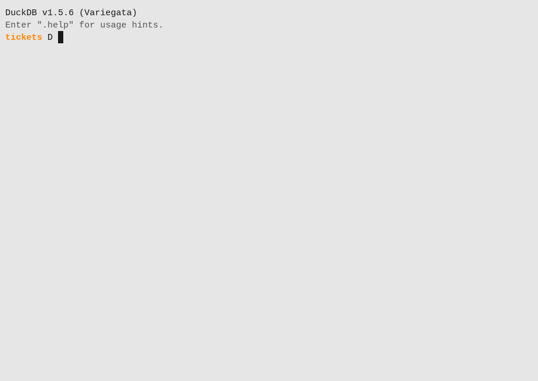

# Improv in DuckDB

The `improv` DuckDB extension brings Improv's formula language and its
multidimensional models to DuckDB: evaluate any built-in function from SQL,
look functions up, and run a model over a table or a query, getting back one
row per computed cell.

Where [`pg_improv`](./postgres.md) keeps a model in Postgres and keeps its
results current as the data changes, the DuckDB extension is stateless.
`improv(source, model)` reads the source, computes, and returns rows, the
way an analytical query does. Nothing is stored and there is nothing to
keep in sync. It is single-user too: it applies no access policies, and
reads whatever the DuckDB connection reads. To keep a model *in* a DuckDB
file, edited live by several people under access policies, see
[DuckDB-hosted models](#duckdb-hosted-models).

<video src="./img/duckdb-demo.mp4" controls muted loop playsinline width="100%"
  poster="./img/duckdb-demo.png">
  
</video>

*The DuckDB v1.5.6 CLI with the extension loaded runs the
[tutorial](./tutorial-duckdb.md)'s queries, the model a little shorter:
`improv_calc`, the Parquet file, the model, a `PIVOT` over its result, and
a query as the source.*

## Install

```sql
INSTALL improv FROM community;   -- once it is in the community registry
LOAD improv;
```

A local build (see [`crates/duckdb_improv/README.md`][readme]) is unsigned:

```sh
duckdb -unsigned -c "LOAD 'crates/duckdb_improv/build/release/improv.duckdb_extension'; ..."
```

One binary loads into DuckDB v1.5.6 and later, v2.0 included.

[readme]: https://codeberg.org/gregburd/improv/src/branch/main/crates/duckdb_improv/README.md

## Formulas: `improv_calc`

```sql
SELECT improv_calc('ROUND(PMT(rate/12, n, -pv), 2)',
                   json_object('rate', 0.06, 'n', 360, 'pv', 200000));
-- 1199.1

SELECT loan_id,
       improv_calc('ROUND(PMT(rate/12, years*12, -principal), 2)',
                   json_object('rate', rate, 'years', years, 'principal', principal)) AS payment
FROM loans;
```

`improv_calc(formula [, inputs])` evaluates one formula in
[Improv's formula language](./formulas.md): operators, `IF` and its
family, `LET`, `LAMBDA`, and the scalar forms of the
[built-in functions](./functions.md) (math, rounding, statistics,
financial, text, dates, engineering). An aggregation over a category
(`SUM(x OVER Time)`) needs a model; use `improv(...)` for that.

- **inputs** is a JSON object: `json_object('x', col, ...)` or a literal
  like `'{"x": 2}'`. Each key is a name the formula can use. Its JSON type
  is the input's type: number, boolean or text (DuckDB's `json_object`
  writes a `DATE` as text). A JSON `null` is a missing input, and a result
  that depends on it is NULL: `improv_calc('x + 1', '{"x": null}')` is NULL,
  while `IF(TRUE, 5, x)` is still 5.
- **The result** is a `DOUBLE`: a number; a boolean as 1 or 0; a date as
  its spreadsheet serial number (days since 1899-12-30). Text and error
  values (`1/0` is `#DIV/0!`) are NULL.
- A formula that does not parse or type-check, or inputs that are not a
  JSON object, fail the query with the reason:
  `improv_calc: parse error at 2: unexpected end of input`.
- A leading `=` is allowed (`'=ROUND(2.675, 2)'`).
- Each formula is compiled once per shape of inputs (names and types) and
  cached, so running one formula over a million rows parses it once.

`improv_calc_text(formula [, inputs])` is the same but returns `VARCHAR`:
text results as they are, numbers to 15 significant digits, dates in RFC
3339, and errors as their codes.

```sql
SELECT improv_calc_text('1/0');                                     -- #DIV/0!
SELECT improv_calc_text('UPPER(name) & "!"', json_object('name', 'ada'));  -- ADA!
SELECT improv_calc_text('TEXT(EDATE(DATE(2024, 1, 31), 1), "yyyy-mm-dd")'); -- 2024-02-29
```

## Function help: `improv_functions`

```sql
SELECT name, signature, description FROM improv_functions() WHERE category = 'financial';
SELECT name, signature FROM improv_functions(query := 'payment');
```

One row per built-in function (681): `name`, `category`
(`math`, `financial`, `text`, `datetime`, …), `signature`
(`PMT(rate, nper, pv, [fv=0], [type=0])`), `returns`
(`number | boolean | text | date | any`), `description` and `aliases`
(other spellings, or NULL). With `query :=`, only the functions whose name
or description matches, best match first.

## Models: `improv(source, model)`

```sql
CREATE TABLE sales(year INTEGER, product VARCHAR, price DECIMAL(10,2), qty INTEGER);
INSERT INTO sales VALUES
  (2024, 'WidgetA', 10, 100), (2024, 'WidgetB', 20, 50),
  (2025, 'WidgetA', 11, 70), (2025, 'WidgetA', 11, 50), (2025, 'WidgetB', 20, 40);

SELECT * FROM improv('sales', '
  category Time = year
  category Product = product
  input Price = price max
  input Quantity = qty sum
  Revenue = Price * Quantity
  Share = Revenue / SUM(Revenue OVER Product)
  Growth = Revenue - PREV(Revenue, Time, 1, 0)
');
```

| measure | Time | Product | value | value_text |
|---|---|---|---|---|
| Revenue | 2024 | WidgetA | 1000.0 | 1000 |
| Revenue | 2024 | WidgetB | 1000.0 | 1000 |
| Revenue | 2025 | WidgetA | 1320.0 | 1320 |
| Revenue | 2025 | WidgetB | 800.0 | 800 |
| Share | 2024 | WidgetA | 0.5 | 0.5 |
| Share | 2025 | WidgetA | 0.6226415094339622 | 0.622641509433962 |
| … | | | | |
| Growth | 2025 | WidgetB | -200.0 | -200 |

These are the values `improv eval` gives for the same model (the extension's
test suite checks that).

**source** is a table or view name, or a query: anything starting with
`SELECT`, `WITH`, `FROM` or `VALUES`, or in parentheses.

```sql
SELECT * FROM improv('SELECT * FROM sales WHERE year >= 2025', '...');
SELECT * FROM improv('read_csv(''sales.csv'')', '...');  -- not a query: use FROM
SELECT * FROM improv('FROM read_csv(''sales.csv'')', '...');
```

**model** has one item per line. Blank lines and lines starting with `#`
or `--` are ignored, and keywords are case-insensitive.

```text
category <Name> = <column>
input    <Name> = <column> [sum | avg | min | max | count]
<Name> = <formula>
```

- **`category`** makes a dimension from a column. Its items are the
  column's distinct non-NULL values in the column's own order: numbers
  numerically, dates chronologically, text alphabetically. `PREV` and `NEXT`
  follow that order. Each category becomes a result column of that name.
- **`input`** is a measure read from a column, over every category. Two
  source rows on the same coordinate are an error unless the line names an
  aggregation, which then combines them (`qty sum` above adds 2025's two
  WidgetA rows). Numeric columns of any type are numbers, `BOOLEAN` is a
  boolean and `VARCHAR` is text; `count` counts any type.
- **`Name = formula`** is a derived measure: any formula over the inputs,
  the derived measures above it, and itself through `PREV` (a running
  total is `Balance = PREV(Balance, Time, 1, 0) + Deposits`). Aggregations
  across a category (`SUM(Revenue OVER Product)`), `RANK`, running forms and
  the rest of [the formula language](./formulas.md) all work.
- A column name with spaces or capitals goes in double quotes:
  `category Time = "Fiscal Year"`. DuckDB matches column names
  case-insensitively.
- A source row with a NULL category value is skipped; a NULL input value is
  no cell.

**The result** has one row per derived cell: measures in declaration order,
each measure's cells in item order. Its columns are `measure`, then one
`VARCHAR` column per category (NULL where the measure does not range over
that category: `SUM(x OVER Product)` has no `Product`), then
`value DOUBLE` (NULL for text, booleans and errors) and `value_text`
(every value as text; errors as `#DIV/0!`, …). It is an ordinary table
expression, so you can filter, join and pivot it:

```sql
PIVOT (SELECT * FROM improv('sales', '...') WHERE measure = 'Revenue')
  ON "Time" USING first(value) GROUP BY "Product";
```

**Errors** fail the query and name the line:

```text
improv: model line 2: Quantity: two source rows have the coordinate (2025, WidgetA); add an aggregation (sum, avg, min, max, count or count_distinct) to the input line
improv: model line 1: the source has no column "yr" (it has: year, product, price, qty)
improv: model line 7: definition: parse error at 9: unknown measure: Revnue
```

### Notes

- The source is read through the extension's own connections to the same
  database (a small pool, `IMPROV_DUCKDB_POOL`, default one per core up to
  8). It sees committed data: not rows the calling transaction has written
  but not committed, and not the caller's `TEMP` tables. Materialize those
  into a regular table first.
- The whole result is computed at bind time and written out a chunk at a
  time, so it suits models up to a few million cells: 2.5M distinct cells
  take about 5 s and 1.5 GB. For a model that stays live as its data changes, use
  [pg_improv](./postgres.md) or [`improv stream`](./ways.md#streaming-improv-stream).
- Enum and date inputs are not supported in models yet. A date column works
  as a category.

## DuckDB-hosted models

The extension computes and forgets. A **DuckDB-hosted model** is the
other way round: the model itself (its categories, items, measures,
input cells, views, LAMBDAs and access policies) lives in tables inside
a DuckDB file, the way [pg_improv](./postgres.md) keeps its catalog in
Postgres. Every Improv front end names it with a `duckdb:` target:

```sh
improv init        'duckdb:/srv/plans.duckdb?model=plan'
improv import-csv  'duckdb:/srv/plans.duckdb?model=plan' sales.csv 100 Sales amount t:1:Time p:2:Product
improv policy set  'duckdb:/srv/plans.duckdb?model=plan' plan.cedar
improv-server      'duckdb:/srv/plans.duckdb?model=plan'
```

- **`?model=NAME` is required.** One file holds any number of models; a
  new name makes a new, empty model. A missing file is created by `init`
  and the imports, and refused by the other commands, as a missing store
  file is.
- **One program writes the file at a time.** DuckDB allows one writing
  process per file. While a program has the file open, every other one is
  refused with a message that names the holder (`plans.duckdb is open in
  another program (/usr/bin/improv-server (PID 4242) …)`), never a
  corrupt file.
- **Live and shared: through the server.** `improv-server` opens the file
  before it listens and holds it until it exits. While it runs it is the
  model's one writer: the [web GUI](./web-gui.md) and other `/v1` clients
  edit the model live, the model's [access policies](./policies.md) decide
  what each caller sees and may change, and `GET /v1/changes` brings each
  edit to the others, filtered for each. See
  [The HTTP Server](./server.md#duckdb-hosted-models).
- **The CLI when the server is not running.** Build, import and set the
  policies with `improv`, then start the server; stop it to run the CLI
  again.
- **The desktop GUI and the TUI** reach a DuckDB-hosted model through
  the server too: `improv-gui https://host` or `improv-tui https://host`
  opens what that server serves, as the token's user (see [the desktop
  GUI](./gui-tour.md#a-model-on-a-server)). They do not open a `duckdb:`
  target themselves, and the COSMIC GUI does not reach one yet.

The tables (`improv.model`, `improv.measure`, `improv.cell`,
`improv.policy`, …) are described in
[Storage: the DuckDB store](./storage.md#the-duckdb-store). DuckDB itself
can query them, from a copy or while no Improv program has the file open:

```sql
ATTACH '/srv/plans.duckdb' AS p (READ_ONLY);
SELECT m.name, c.coord, c.value_number
FROM p.improv.cell c JOIN p.improv.measure m USING (model_id)
WHERE m.id = c.measure_id;
```

The file is DuckDB 2.0's format: open it with DuckDB 2.0 or later. The
`improv` extension does not read or write these tables; its
`improv(source, model)` stays stateless and single-user.
