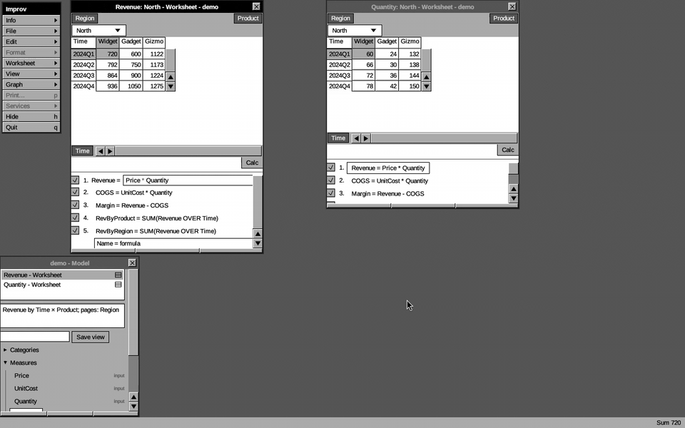
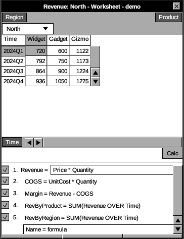
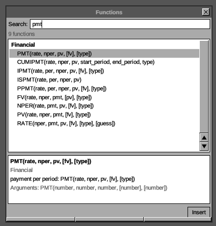
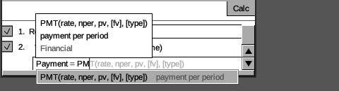
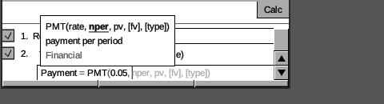
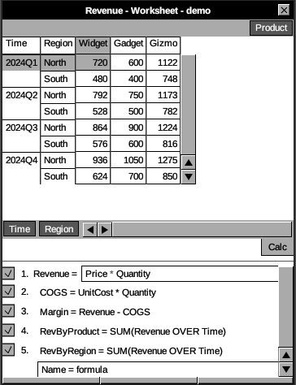
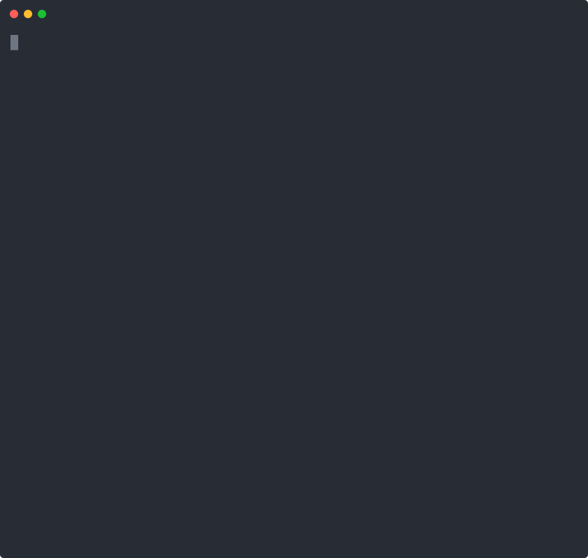
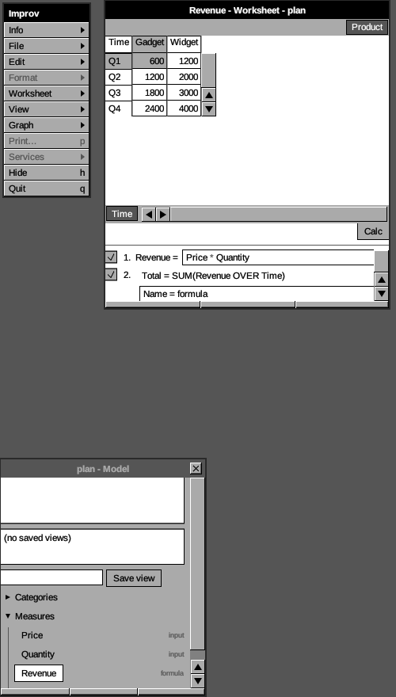

# The Desktop GUI

`improv-gui` is the egui/eframe desktop front-end, styled after the original
NeXTSTEP Lotus Improv: NeXT's four-level grayscale (no color anywhere, a gray
selection), flat controls with 1 px black outlines, worksheet windows with NeXT
title bars on a dark gray workspace, white grid cells, a formula list in each worksheet window, a floating application menu,
on-grid category tiles for pivoting, a model browser window and an Info panel.

Run it (from the Nix dev shell, which provides the GUI runtime libraries):

```sh
bash docs/demo/sample-model.sh sample.db
nix develop -c cargo run -p improv_gui -- sample.db
```

A model opens on its first saved view, or, with none, on its first
measure.

<video src="./img/gui-demo.mp4" controls muted loop playsinline width="100%"
  poster="./img/gui-workspace.png">
  
</video>

*Pivoting by dragging the Region tile, paging, editing a Quantity cell while
the Revenue worksheet recomputes, selecting a range for its Sum, and adding
a formula. Recorded by `docs/demo/gui-movie.sh`.*

## The pivot grid



The window has five regions:

- **Application menu** (floating, top left) — NeXTSTEP's vertical menu. Drag
  its black `Improv` title bar to move it. An item marked with a triangle opens
  a submenu to its right; click it again, press Escape or click elsewhere to
  close it. **Info ▸ Info Panel…** shows or hides the Info panel; **File ▸
  New** starts an empty model (type a new file, a `postgres://` URL, or
  nothing for an in-memory one) and **Open…** opens a store file or URL,
  both in a small panel whose path field has the keyboard (Esc closes
  it); **Save** saves the model, **Save As…** writes it
  to a new file or URL and carries on there (Save does that too for an
  in-memory model), **Revert to Saved**
  reloads it from the store (the way out of a save conflict), and
  **Import/Export CSV…** opens the CSV wizard; **Edit** has Undo and Redo;
  **Format** sets how the selected measure's numbers show (see [Number
  formats](#number-formats));
  **Worksheet** has Pivot, Add Matrix, Remove Matrix, Save View, and **Add
  Category**, **Add Item** and **Add Input Measure** (see [Building a model
  from scratch](#building-a-model-from-scratch)), **Rename** and **Delete…**
  (see [Renaming and deleting](#renaming-and-deleting)); **View** has **Model Browser**, which shows or hides the model browser,
  then lists the saved views, with a check on the
  current one, and picking one switches the workspace to it; **Graph ▸ Show
  Chart** toggles the chart; **Help ▸ Functions…** (also F1) opens the
  [function help](#function-help), **Help ▸ Keys…** a window listing the
  [keys](#keyboard-and-screen-readers), and **Help ▸ User Guide** this
  guide, online, in the browser; **Hide** minimizes and **Quit** closes the
  window. Print and Services, and Close in the File
  menu, are not built yet and draw grayed out. Key equivalents, shown at
  the right of their item, take Ctrl (Cmd on macOS): `n` new, `o` open,
  `s` save, `z` undo, `Z` (Shift+Z) or `y` redo, `h` hide, `q` quit. They don't fire while a text
  field has focus.
- **Model browser** (window, bottom left of the workspace) — titled
  `<file> - Model`. It leads with a white list of saved views, one
  `Name - Worksheet` row each with a worksheet icon: click a row to select it
  and read its description below (measure, categories, pages); double-click
  to open it (a view saved by `improv save-view`, which has no window
  position, opens right of the menu). Under that, a name field and **Save view** save the current
  canvas. Collapsed below are Categories (with their items) and Measures (each
  labeled `input` or `formula` at the right; click one to select it), each
  list ending in a line that adds one, and the named LAMBDAs, once there
  are any. Its close box hides it; **View ▸ Model Browser** brings it back.
- **Worksheet windows** (center) — the dark gray workspace holds one
  window per matrix, titled `<matrix> - Worksheet - <file>`. Drag a title bar
  to move a window and its bottom bar to resize it (the left third drags the
  bottom-left corner, the right third the bottom-right). Clicking a window
  makes it key (black title bar) and gives its matrix the keyboard. With more
  than one matrix open, each window's close box removes its matrix.
  **Worksheet ▸ Add Matrix** opens another window the size of the last
  one, beside it, or below it, where the workspace has room and no window
  is covered; else it cascades from the last one, its title bar showing.
  **Save View** records every window's place and size. A fresh window
  opens right of the menu, sized to its grid.
- **Pivot grid** (in each worksheet window) — the measure projected onto the
  current axes. Here Revenue is shown with **Product** on columns, **Time** on rows,
  and **Region** paged. The **category tiles** are dark-gray chips, placed as in
  NeXT Improv: page tiles top-left, each above a white item field (click it to
  pick the page shown; `[` / `]` and PageUp / PageDown step it too), column
  tiles top-right, row tiles bottom-left beside the scroller. Drag a tile to
  another strip to re-pivot without touching the formula (the strips light up
  as drop targets only while you drag), or right-click it and choose
  **Move to Rows / Columns / Pages**. The same menu filters the category:
  uncheck an item to hide it from this worksheet, or choose **Show all**; a
  filtered tile reads `Name*`. Its last line, **New item**, adds an item to
  the category: type the name and press Enter.
  Cells are white with thin black rules; the selection and its row and column
  headers turn gray. Click a cell to select it and type to replace its
  value; **double-click** it (or press Enter / F2) to edit it with its value
  selected. Enter commits, Esc cancels. A number cell takes `1500`,
  `-3.5`, `1,500.25` and `$1,500` (a leading `$`, `€`, `£` or `¥`; in a
  German locale, `IMPROV_LOCALE=de`, `1.500,25` and `€1.500`). An entry
  the cell refuses (`1,50` in a number cell) stays in the editor, with
  the reason and the forms it takes in the status line, to correct or
  cancel. Input cells carry a
  faint underline; hover a derived cell to see its formula. Arrows (or
  `h` `j` `k` `l`) move the cursor, and `n` / Shift+`n` show the next or
  previous measure. **Shift+arrows**, Shift+click or a drag select a range,
  and the status bar shows its **Sum**.
- **Formula list** (bottom of each worksheet window) — every formula,
  numbered, with a **Calc** button above and a checkbox that enables it.
  Click a row to select its measure; the selected row becomes an editor:
  Enter commits (re-typechecks and recomputes), Esc reverts. Type
  `Name = formula` on the last line and press Enter to add a measure, or
  `Name = LAMBDA(p, …, body)` to define a named LAMBDA (as `improv
  define` does); typing an existing LAMBDA's name redefines it. A
  formula that fails, in either editor, stays as typed with the fault
  underlined (see [Formula errors](#formula-errors)).
- **Info panel** (window, top right of the workspace, closed at start) —
  opened by **Info ▸ Info Panel…**: the selected measure's id, kind, value
  type, number format, dimensions, dependencies, and formula. An input measure has a box
  per category, checked for its dimensions: check one to add it (the
  cells go to its first item), uncheck one to drop it (the cells at its
  first item stay, the rest go; the status line counts them). The
  formulas that read the measure take their new shape, and a change that
  would break one is refused with the reason. It is one undo step. Its
  close box closes it.
- **Status bar** (bottom) — the last action's outcome (`saved model`, or
  `saving…` until File ▸ Save's write lands, `recalculated`, `undo`,
  `added Margin`, or an error) on the left, cleared
  after 5 seconds, and the selection's **Sum** on the right. While the
  formulas recompute after a structural change (a new or edited formula,
  an import, its undo, opening a model), it also says **Recalculating…**.
  While a model opens, the window shows at once and says **Loading…** (the
  desk and the title too) until its store has been read; only Quit, Hide
  and User Guide work until then.
  That takes a second or two at a million cells. The window keeps
  responding: the grid shows the last results until the new ones are
  ready, and cell edits made meanwhile are applied to them.

The native window title reads `Improv — <file>` (`Untitled` in memory), with
a trailing `•` while the model has edits that are not saved: any edit of an
in-memory model, or a model whose autosave is still running or failed. To keep an
in-memory model, choose **File ▸ Save** and type a path: the model is
written there, the window switches to it and autosaves to it from then on,
and Undo still works. Quitting an edited in-memory model asks for a second
Quit.

Every edit autosaves, in one transaction, in the background: the window
does not wait for the file. The title's `•` stays until the store has the
edit. If a save fails, the edit stays in the window, still marked `•`,
and the status line says it is not saved yet and why:

- **The disk is full** (or the file can't be written): free some space.
  The next edit, or **File ▸ Save**, writes everything that was not saved,
  and the status line says so.
- **Another program changed this model** since you opened it: nothing is
  overwritten, and nothing from this window is saved until you reload. The
  **Changed** panel opens; **Reload** (File ▸ Revert to Saved) loads their
  changes and drops yours, which you then make again.

Quit and the window's close box wait for a save that is still running.
If a change could not be saved, the first Quit says so and a second one
discards it; File ▸ Open… refuses until it is saved or reverted.

Every two seconds the GUI checks whether another program saved the
model. When one has, a **Changed** panel offers **Reload** (File ▸ Revert
to Saved: their changes come in and the undo history is dropped) or
**Not Now**, which hides it until they save again. Until you reload, a
save from this window is refused as above, so nothing is overwritten.

A crash or a `kill -9` during a save loses only that save. The file reopens
with every earlier edit and nothing half-written.

## Building a model from scratch

Start `improv-gui` with no model, or choose **File ▸ New** and type a path
for the new store. The empty workspace says where to begin, right of the
menu. Then, all undoable with Ctrl+Z and autosaved after each step:

1. **Worksheet ▸ Add Category** opens the model browser's Categories list
   at its **New category** line. Type `Time`, Enter; the line clears, so
   type `Product` and Enter again.
2. **Add Item**: open a category in the browser and type into its **New
   item** line, or right-click the category's tile in a worksheet and type
   into the tile's **New item** line. **Worksheet ▸ Add Item** jumps to the
   line of the worksheet's first row category.
3. **Worksheet ▸ Add Input Measure**: type `Price` for a measure over
   every category, or name its categories after a colon, `Price:
   Product`, as the TUI's `n` takes them (`Price:` alone is a single
   cell). An empty worksheet shows it. Click a cell and type its value.
4. Add formulas on the formula list's last line: `Revenue = Price *
   Quantity`, or a named LAMBDA, `Margin = LAMBDA(p, c, p - c)`, which
   the browser then lists under LAMBDAs and any formula can call:
   `Net = Margin(Revenue, Cost)`.

A name already used by a category, a measure or a LAMBDA is refused, and
the status line says why; so is a measure name with a comma.

## Renaming and deleting

Click a category, an item, a measure or a saved view in the model
browser to pick it. **Worksheet ▸ Rename** and **Delete…** act on the
pick, or on the focused worksheet's measure when nothing is picked.
**Worksheet ▸ Save View** with the browser's name field empty saves
"view N" and opens its rename line, so typing names it.

- **Rename:** the row turns into a line holding the name, selected. Type
  the new name and press Enter; Esc keeps the old one. Double-clicking an
  item or a measure does the same. Formulas follow the new name. A name
  already used is refused, and the line stays open with the reason in the
  status line.
- **Delete…** asks first, in a small panel that says what goes with it: an
  input measure's cells, an item's cells, a category's items. Delete (or
  Enter) deletes, Cancel (or Esc) keeps it. A saved view loses a deleted
  measure's worksheets, and is deleted if none is left. A measure that a
  formula reads cannot be deleted, nor can a category that a measure ranges
  over or names. The status line names what still needs it, as
  `improv.drop_measure` does: `cannot delete Revenue: Margin still
  references it (delete or redefine it first)`. Deleting a view leaves
  its worksheets open. A view's name need only differ from the other
  views'.

Each rename and delete autosaves and is one undo step.

## Number formats

**Format** sets how the selected measure's numbers show, in every
worksheet: **General** (as many digits as the value needs, at most 15
significant), **0 Decimals** to **4 Decimals**, and **Thousands
Separators**, which turns grouping on or off and keeps the decimals. A
check marks the format in effect. `299.666666666667` shows as `299.67` at
two decimals, `1234567.891` as `1,234,568` at none with separators.
Decimals round half away from zero (`2.5` shows as `3`). The separators
follow the formula locale (`IMPROV_LOCALE`): `1.234,50` in German.

A format is presentation only. The value keeps every digit: formulas, the
CSV and SQL exports and Postgres see it unrounded, and editing a cell
starts from the value as typed, not as shown. The Sum in the status bar
and the Info panel follow the format. Each change autosaves and is one
undo step; the measure keeps its format in the file or database. Format is
grayed out for a measure that holds text, booleans or dates.

## Keyboard and screen readers

Everything works from the keyboard. In a worksheet the arrows move, typing
replaces the cell's value, Enter or F2 edits it, Enter commits and Esc
cancels; `[` and `]` page. The grid's own keys (`h j k l n [ ]`) keep
their jobs, so a text value that starts with one is typed after Enter. Tab moves
through the menu, the windows' fields and buttons, and Enter or Space
presses the focused one, so **Tab** to a menu item and **Enter** opens
its submenu or runs it. The key equivalents (Ctrl or Cmd: `n o s z Z y h
q`) work anywhere outside a text field. **Help ▸ Keys…** lists them all.

Every control has an accessible name (through AccessKit, which egui feeds
to Orca, VoiceOver and Narrator): menu items by their label, a cell by
its row and column items and its value (`2025, WidgetA: 100`), a tile by
its category and axis, and text fields by what they ask for. The four
grays meet WCAG contrast: black text is 21:1 on cells and 9:1 on panels,
white tile text 7.5:1.

## Function help

**Help ▸ Functions…**, or F1 from anywhere (a formula edit included), opens
the Functions window at the workspace's right: a search line, the matching
functions grouped by category with their signatures, and the selected
one's details. The search matches names, aliases and descriptions, best
first (`pmt` finds PMT, then IPMT, PPMT, …; `payment` finds them by
description). Up and Down move the selection. The details show the
signature with the parameter names (`PMT(rate, nper, pv, [fv], [type])`,
`[optional]`, `…` repeating), the category and aliases, the description,
and the argument types. **Insert**, a double-click or Enter puts `NAME(`
into the formula you were editing (the selected row's, else the
`Name = formula` line), at the caret, and returns the keyboard to it.



## Autocomplete

Both formula editors complete as you type. Start a name (`PM`, `Qua`, or a
quoted `'Unit`) and a list drops under the edit: matching functions with
their signatures and a dimmed one-line description, then the model's
measures and categories, at most eight. Up and Down move the selection;
Tab or Enter accepts it, Esc closes the list. With the list closed, Enter
commits the formula as before. Accepting a function writes `NAME(` with
the caret after the `(`; a measure or category named with spaces is
quoted for you (`'Unit Cost'`).

While the caret is at the end of the text, the rest of the selected name
and its parameters trail it in light gray (`PM` shows `T(rate, nper, pv,
[fv], [type])`). Inside a call the parameters still to give trail it: after
`PMT(0.05, ` they read `nper, pv, [fv], [type])`. A tooltip over the edit
shows the signature with the argument the caret is in **bold and
underlined**, the description and the category.





## Formula errors

When a formula fails, the place it fails is underlined in the editor, and
under the row are the message and, dimmed, why. The editor keeps the
keyboard, with the caret at the start of the underlined part, so you can
correct it and press Enter again:

- an unknown measure or category: `did you mean Price?`, the nearest names
  in the model (a misspelled function's suggestion is in the message
  itself: `unknown function: PMTT; did you mean PMT?`);
- the wrong number of arguments: the call's name is underlined, the
  message spells the parameters, and the hint says what is off,
  `missing pv: 2 given`;
- a `(` never closed: that `(` is underlined, `( opened here is never
  closed: add )`;
- an aggregation without `OVER`: its form, `IRR(values OVER T,
  [guess=0.1])`.

A type or dimension error has no position, so the editor underlines the
first function or measure the message names (in `Quantity + LEN(Price)`,
`LEN`). A row whose saved formula no longer compiles shows its error the
same way. Editing the text clears the mark.

## Stacked axes

Drag the **Region** tile from the top-left pages strip onto the bottom row strip and the
row axis becomes the *stacked* product of Time × Region:



Each Time group (2024Q1, 2024Q2, …) now expands into its Region rows
(North / South), with the outer Time label printed once per group. Any number of
categories can stack on either axis; the grid renders the full Cartesian
product, and rows are **virtualized** so a stacked axis of millions of lines
stays responsive.

## Incremental recalculation

Editing an input cell propagates as a delta through differential dataflow — only
the touched cells and their dependents recompute. The same behavior on the CLI:



## A model in Postgres

The GUI opens a model stored in Postgres from its URL,
`improv-gui 'postgres://me@127.0.0.1/sales?sslmode=disable&model=plan'`. Input
measures bound to a table show that table's rows, and editing a cell updates
the row. Here the price of Q1 Widget was changed in SQL, and the GUI shows
the recomputed revenue (1200):



## Recording the movie and screenshots

`docs/demo/gui-movie.sh` rebuilds the demo model, runs the GUI on a headless
X server and records the movie above with `ffmpeg`, driving it with
`xdotool`. `scripts/gui-shot.sh` takes the screenshot the CI compares
against its golden image.
