# The Desktop GUI

`improv-gui` is the egui/eframe desktop front-end, styled after the original
NeXTSTEP Lotus Improv: NeXT's four-level grayscale (color only in graphs,
as Improv's own; a gray selection), flat controls with 1 px black outlines, worksheet windows with NeXT
title bars on a dark gray workspace, white grid cells, a formula list in each worksheet window, a floating application menu,
on-grid category tiles for pivoting, a model browser window and an Info panel.

Run it (from the Nix dev shell, which provides the GUI runtime libraries):

```sh
bash docs/demo/sample-model.sh sample.db
nix develop -c cargo run -p improv_gui -- sample.db
```

A model opens on its first saved view, or, with none, on its first
measure. The same worksheets run in a browser, served by `improv-server`
([The Web GUI](./web-gui.md)), and [`improv-cosmic`](./cosmic-gui.md)
is a native COSMIC application on the same models.

<video src="./img/gui-demo.mp4" controls muted loop playsinline width="100%"
  poster="./img/gui-demo.png">
  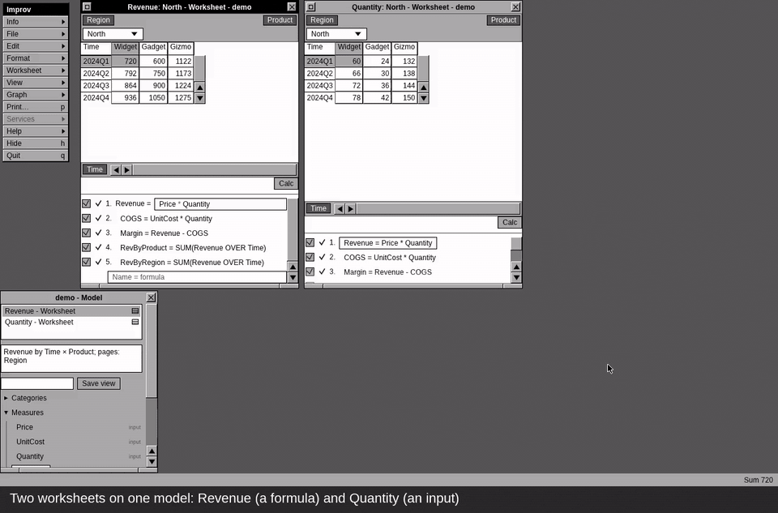
</video>

*Pivoting by dragging the Region tile, paging, editing a Quantity cell
while the Revenue worksheet recomputes, a formula typed with
autocomplete, a color graph in two of its types, and the Inspector
turning the grid lines off. A caption under the screen says what each
step does. Recorded by `docs/demo/gui-movie.sh`.*

## The pivot grid

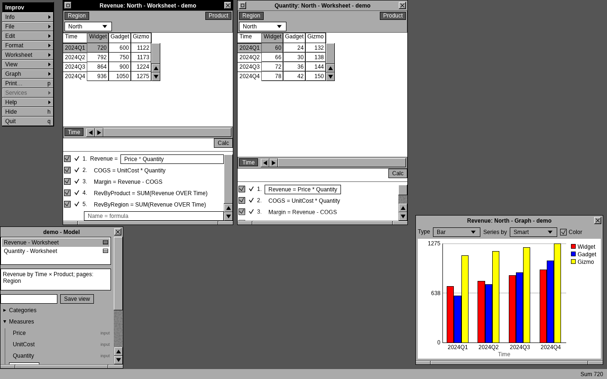

*The whole workspace: the main menu at the top left, two worksheets on
one model, the model browser under them and a graph of the Revenue
worksheet.*

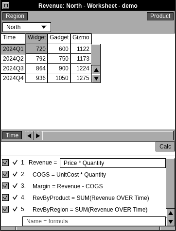

*One worksheet window: Revenue with Region paged (North), Product on the
columns, Time on the rows, and the formula list under the grid.*

The window has five regions:

- **Application menu** (floating, top left) — NeXTSTEP's vertical menu. Drag
  its black `Improv` title bar to move it. An item marked with a triangle opens
  a submenu to its right; click it again, press Escape or click elsewhere to
  close it. The menus are Lotus Improv 1.0's, in its order and with its
  key equivalents, holding the commands this GUI has. **Info ▸ Info
  Panel…** shows or hides the Info panel; **Context Help…** and **Point
  for Help** open the Help window (see [Context help](#context-help)). **File ▸ Open…** opens a store
  file or URL and **New** starts an empty model (type a new file, a
  `postgres://` URL, or nothing for an in-memory one), both in a small
  panel whose path field has the keyboard (Esc closes it); **Save** saves
  the model, **Save As…** writes it to a new file or URL and carries on
  there (Save does that too for an in-memory model), **Revert to Saved**
  reloads it from the store (the way out of a save conflict), **Model
  Browser…** shows or hides the model browser, **Close** closes the model
  to an empty desk (unsaved edits warn first, as Quit does; a second Close
  drops them), and **Import/Export CSV…** opens the CSV wizard. **Edit** has Undo and Redo (which Improv 1.0
  lacked), **Cut**, **Copy**, **Paste** (see [Copy and paste](#copy-and-paste)) and
  **Select All**, the whole worksheet, **Select Items Only** and **Select
  Cells Only** (see [Selecting](#selecting)), **Inspector…** (see [The
  Inspector and the Format panel](#the-inspector-and-the-format-panel)),
  **Add Category**, **Add Item** and **Add Input Measure** (see
  [Building a model from scratch](#building-a-model-from-scratch)),
  **Rename** and **Delete…** (see [Renaming and
  deleting](#renaming-and-deleting)). **Format** has the **Format
  Panel…**, sets how the selected measure's numbers show (see [Number
  formats](#number-formats)), and has **Report Layout…** and **Page
  Layout…** (see [Printing](#printing)). **Print…** prints the focused
  worksheet.
  **Worksheet** has **Recalculate** (the formula pane's Calc) and **Save
  View**. **View** has **New View**, another worksheet window on the
  model, **Close Window** (Ctrl+W), and **Swap Rows/Columns**, then the saved
  views, with a check on the current one; picking one switches the
  workspace to it. **Graph ▸ New Graph** opens the [graph
  window](#graphs). **Help ▸ Functions…** (also F1) opens the [function
  help](#function-help), **Help ▸ Keys…** a window listing the
  [keys](#keyboard-and-screen-readers), and **Help ▸ User Guide** this
  guide, online, in the browser. **Hide** minimizes and **Quit** closes
  the window. Services is not built yet and draws grayed out.
  Key equivalents are shown at the right of their item; a capital letter
  means Shift too. See [the key equivalents](#key-equivalents).
- **Model browser** (window, bottom left of the workspace) — titled
  `<file> - Model`. It leads with a white list of saved views, one
  `Name - Worksheet` row each with a worksheet icon: click a row to select it
  and read its description below (measure, categories, pages); double-click
  to open it (a view saved by `improv save-view`, which has no window
  position, opens right of the menu). Under that, a name field and **Save view** save the current
  canvas. Collapsed below are Categories (with their items) and Measures (each
  labeled `input` or `formula` at the right; click one to select it), each
  list ending in a line that adds one, and the named LAMBDAs, once there
  are any. Its close box hides it; **File ▸ Model Browser…** brings it back.
- **Worksheet windows** (center) — the dark gray workspace holds one
  window per matrix, titled `<matrix> - Worksheet - <file>`. Drag a title bar
  to move a window and its bottom bar to resize it (left of its left notch drags the
  bottom-left corner, right of the right notch the bottom-right, between them the bottom edge). Clicking a window
  makes it key (black title bar) and gives its matrix the keyboard; while
  a panel has the keyboard the worksheet you were in keeps a dark-gray
  title bar, and other windows' are light gray, as on NeXTSTEP. The close
  box is drawn broken while the model has unsaved changes, and the button
  at the title bar's left minimizes the GUI's window. With more
  than one matrix open, each window's close box removes its matrix.
  **View ▸ New View** opens another window the size of the last
  one, beside it, or below it, where the workspace has room and no window
  is covered; else it cascades from the last one, its title bar showing.
  **Save View** records every window's place and size. A fresh window
  opens right of the menu, sized to its grid.
- **Pivot grid** (in each worksheet window) — the measure projected onto the
  current axes. Here Revenue is shown with **Product** on columns, **Time** on rows,
  and **Region** paged. The **category tiles** are dark-gray chips, placed as in
  NeXT Improv: page tiles top-left, each above a white item field (click it to
  pick the page shown; `[` / `]` and PageUp / PageDown step it too), column
  tiles top-right, row tiles bottom-left beside the scroller. Drag a tile to
  another strip to re-pivot without touching the formula (the strips light up
  as drop targets only while you drag), or right-click it and choose
  **Move to Rows / Columns / Pages**. The same menu filters the category:
  uncheck an item to hide it from this worksheet, or choose **Show all**; a
  filtered tile reads `Name*`. Its last line, **New item**, adds an item to
  the category: type the name and press Enter.
  Cells are white with thin black rules; the selection and its row and column
  headers turn gray. Click a cell to select it and type to replace its
  value; **double-click** it (or press Enter / F2) to edit it with its value
  selected. Enter commits, Esc cancels. A number cell takes `1500`,
  `-3.5`, `1,500.25` and `$1,500` (a leading `$`, `€`, `£` or `¥`; in a
  German locale, `IMPROV_LOCALE=de`, `1.500,25` and `€1.500`). An entry
  the cell refuses (`1,50` in a number cell) stays in the editor, with
  the reason and the forms it takes in the status line, to correct or
  cancel. Input cells carry a
  faint underline; hover a derived cell to see its formula. Arrows (or
  `h` `j` `k` `l`) move the cursor, and `n` / Shift+`n` show the next or
  previous measure. **Shift+arrows**, Shift+click or a drag select a range,
  and the status bar shows its **Sum**.
- **Formula list** (bottom of each worksheet window) — every formula,
  numbered, with a **Calc** button above, a checkbox that enables it, and
  Improv's status indicator: a check when the formula checks, a cross when
  it has an error.
  Click a row to select its measure; the selected row becomes an editor:
  Enter commits (re-typechecks and recomputes), Esc reverts. Type
  `Name = formula` on the last line and press Enter to add a measure, or
  `Name = LAMBDA(p, …, body)` to define a named LAMBDA (as `improv
  define` does); typing an existing LAMBDA's name redefines it. A
  formula that fails, in either editor, stays as typed with the fault
  underlined (see [Formula errors](#formula-errors)).
- **Info panel** (window, top right of the workspace, closed at start) —
  opened by **Info ▸ Info Panel…**: the selected measure's id, kind, value
  type, number format, dimensions, dependencies, and formula. An input measure has a box
  per category, checked for its dimensions: check one to add it (the
  cells go to its first item), uncheck one to drop it (the cells at its
  first item stay, the rest go; the status line counts them). The
  formulas that read the measure take their new shape, and a change that
  would break one is refused with the reason. It is one undo step. Its
  close box closes it.
- **Status bar** (bottom) — the last action's outcome (`saved model`, or
  `saving…` until File ▸ Save's write lands, `recalculated`, `undo`,
  `added Margin`, or an error) on the left, cleared
  after 5 seconds, and the selection's **Sum** on the right. While the
  formulas recompute after a structural change (a new or edited formula,
  an import, its undo, opening a model), it also says **Recalculating…**.
  While a model opens, the window shows at once and says **Loading…** (the
  desk and the title too) until its store has been read; only Quit, Hide
  and User Guide work until then.
  That takes a second or two at a million cells. The window keeps
  responding: the grid shows the last results until the new ones are
  ready, and cell edits made meanwhile are applied to them.

The native window title reads `Improv — <file>` (`Untitled` in memory), with
a trailing `•` while the model has edits that are not saved: any edit of an
in-memory model, or a model whose autosave is still running or failed. To keep an
in-memory model, choose **File ▸ Save** and type a path: the model is
written there, the window switches to it and autosaves to it from then on,
and Undo still works. Quitting an edited in-memory model asks for a second
Quit.

Every edit autosaves, in one transaction, in the background: the window
does not wait for the file. The title's `•` stays until the store has the
edit. If a save fails, the edit stays in the window, still marked `•`,
and the status line says it is not saved yet and why:

- **The disk is full** (or the file can't be written): free some space.
  The next edit, or **File ▸ Save**, writes everything that was not saved,
  and the status line says so.
- **Another program changed this model** since you opened it: nothing is
  overwritten, and nothing from this window is saved until you reload. The
  **Changed** panel opens; **Reload** (File ▸ Revert to Saved) loads their
  changes and drops yours, which you then make again.

Quit and the window's close box wait for a save that is still running.
If a change could not be saved, the first Quit says so and a second one
discards it; File ▸ Open… refuses until it is saved or reverted.

Every two seconds the GUI checks whether another program saved the
model; on a Postgres model under pg_improv 0.15 or later it listens
instead (a second connection that `LISTEN`s for the model's
notifications; see [Live updates](./postgres.md#live-updates)), so it
knows at once and reads nothing in between. When one has, a **Changed**
panel offers **Reload** (File ▸ Revert
to Saved: their changes come in and the undo history is dropped) or
**Not Now**, which hides it until they save again. Until you reload, a
save from this window is refused as above, so nothing is overwritten.

A crash or a `kill -9` during a save loses only that save. The file reopens
with every earlier edit and nothing half-written.

## Building a model from scratch

Start `improv-gui` with no model, or choose **File ▸ New** and type a path
for the new store. The empty workspace says where to begin, right of the
menu. Then, all undoable with Ctrl+Z and autosaved after each step:

1. **Edit ▸ Add Category** opens the model browser's Categories list
   at its **New category** line. Type `Time`, Enter; the line clears, so
   type `Product` and Enter again.
2. **Add Item**: open a category in the browser and type into its **New
   item** line, or right-click the category's tile in a worksheet and type
   into the tile's **New item** line. **Edit ▸ Add Item** jumps to the
   line of the worksheet's first row category.
3. **Edit ▸ Add Input Measure**: type `Price` for a measure over
   every category, or name its categories after a colon, `Price:
   Product`, as the TUI's `n` takes them (`Price:` alone is a single
   cell). An empty worksheet shows it. Click a cell and type its value.
4. Add formulas on the formula list's last line: `Revenue = Price *
   Quantity`, or a named LAMBDA, `Margin = LAMBDA(p, c, p - c)`, which
   the browser then lists under LAMBDAs and any formula can call:
   `Net = Margin(Revenue, Cost)`.

A name already used by a category, a measure or a LAMBDA is refused, and
the status line says why; so is a measure name with a comma.

## Renaming and deleting

Click a category, an item, a measure or a saved view in the model
browser to pick it. **Edit ▸ Rename** and **Delete…** act on the
pick, or on the focused worksheet's measure when nothing is picked.
**Worksheet ▸ Save View** with the browser's name field empty saves
"view N" and opens its rename line, so typing names it.

- **Rename:** the row turns into a line holding the name, selected. Type
  the new name and press Enter; Esc keeps the old one. Double-clicking an
  item or a measure does the same. Formulas follow the new name. A name
  already used is refused, and the line stays open with the reason in the
  status line.
- **Delete…** asks first, in a small panel that says what goes with it: an
  input measure's cells, an item's cells, a category's items. Delete (or
  Enter) deletes, Cancel (or Esc) keeps it. A saved view loses a deleted
  measure's worksheets, and is deleted if none is left. A measure that a
  formula reads cannot be deleted, nor can a category that a measure ranges
  over or names. The status line names what still needs it, as
  `improv.drop_measure` does: `cannot delete Revenue: Margin still
  references it (delete or redefine it first)`. Deleting a view leaves
  its worksheets open. A view's name need only differ from the other
  views'.

Each rename and delete autosaves and is one undo step.

## Number formats

**Format** sets how the selected measure's numbers show, in every
worksheet: **General** (as many digits as the value needs, at most 15
significant), **0 Decimals** to **4 Decimals**, and **Thousands
Separators**, which turns grouping on or off and keeps the decimals. A
check marks the format in effect. `299.666666666667` shows as `299.67` at
two decimals, `1234567.891` as `1,234,568` at none with separators.
Decimals round half away from zero (`2.5` shows as `3`). The separators
follow the formula locale (`IMPROV_LOCALE`): `1.234,50` in German.

A format is presentation only. The value keeps every digit: formulas, the
CSV and SQL exports and Postgres see it unrounded, and editing a cell
starts from the value as typed, not as shown. The Sum in the status bar
and the Info panel follow the format. Each change autosaves and is one
undo step; the measure keeps its format in the file or database. Format is
grayed out for a measure that holds text, booleans or dates.

## The Inspector and the Format panel

Improv's two multiform panels: a pop-up list at the top picks the page,
and each works on the focused worksheet, following the focus to another
one as a NeXT panel follows the selection.

**Edit ▸ Inspector…** has three pages; **OK** applies them to the
worksheet and **Revert** reads it back:

- **Grid**: **Show Grid Lines**, and **Lines In** the **Cell Area**, the
  **Item Area** (the item headers) or **Both**.
- **Layout**: **Show Markers ▸ Hidden Items**, the `*` on a filtered
  category's tile.
- **Formulas**: **Show Errors In Line**. Off, a formula's error moves from
  under its row to its status indicator's tip.

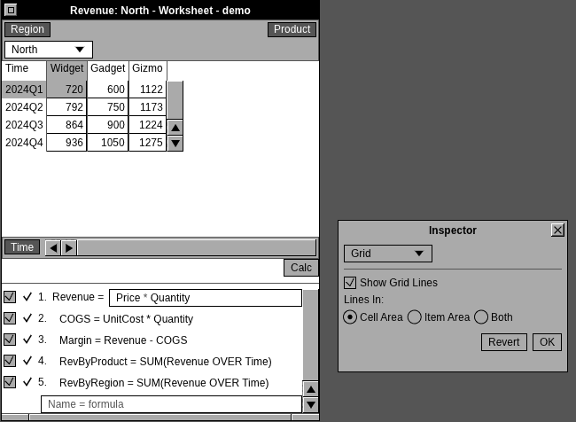

*The Inspector on its Grid page, Lines In the Cell Area: the worksheet
beside it keeps its cell rules and drops the ones between the item
names.*

**Format ▸ Format Panel…** (Ctrl+Shift+F) has two pages over a sample;
**Set** applies both:

- **Number**: **General** or **Specific** with its **Decimal Places**
  (0 to 15), and **Commas** (thousands separators). It sets the measure's
  format, as the Format menu's rows do, as one undo step.
- **Alignment**: **Smart** (numbers right, text left), **Left**,
  **Center** or **Right**, for the worksheet's cells.

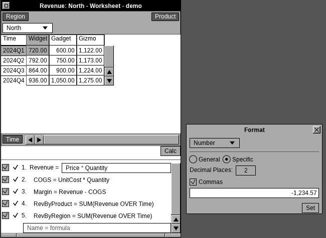

*The Format panel's Number page after **Set**: two decimal places with
commas, in the sample and in the worksheet.*

The worksheet's options (the Inspector's, and the alignment) stay with its
window for the session; they are not saved in the view yet. Improv's
Inspector also had its recalculation controls and group-collapse and
page-break markers, and its Format panel Line Style, Color, custom and
date/time pages; those have no engine or view state to set here.

## Printing

**Print…** (Ctrl+P) prints the focused worksheet as it shows: its item
names and cells in their number format and alignment, ruled as the
Inspector's Grid page says, split across as many pages as it needs with
the item names repeated on each. The Print panel has **Copies**, **Pages**
(All, or From and To), and **Print Selected Data Only** (when more than
one cell is selected), then:

- **Print**: to the platform's print system. On Linux, macOS and the BSDs
  that is CUPS's `lp` (or BSD `lpr`), sent as PDF; on illumos the LP
  service's `lp`, sent as PostScript. **Printer** names a queue; empty is
  the default one. On Windows, Print opens the Windows print dialog and
  prints with the printer it picks. With no `lp` or `lpr`, Print is grayed.
- **Save as PDF** and **Save as PostScript**: write the pages to **File**
  (`.pdf` or `.ps`; it starts as the model's name).

**Format ▸ Page Layout…** sets the **Paper Size** (Letter, Legal, A4), the
**Orientation** (Portrait or Landscape) and the **Scale** (50% prints at
half size, so more fits on a page).

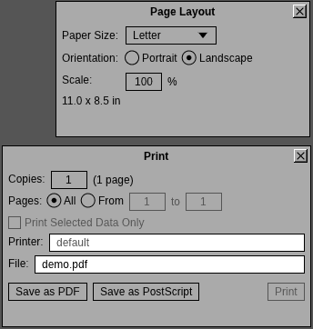

*Page Layout (Letter, landscape) above the Print panel. With no print
system on this machine, Print is grayed, and the pages go to
`demo.pdf`.*

**Format ▸ Report Layout…** sets the **Header** and **Footer**, each with
a left, a centered and a right part, the **First Page Number**, **Number
Pages** (Top to Bottom: down a column of pages first; Left to Right:
across first), and the **Content**: **Data** (the items and cells),
**Formulas** (the numbered formula list, on pages of its own), or both.
A header or footer can hold Improv's markers, typed or inserted from its
field's right-click menu: `<Date>`, `<Time>`, `<View Name>`, `<Worksheet
Name>`, `<Model Name>` and `<Page #>`. The default header is the worksheet's
name and the default footer `Page <Page #>`.

The layouts are kept for the session, not saved with the model yet.
Pages are in Helvetica, which every printer and PDF reader has.

## Graphs

**Graph ▸ New Graph** charts the focused worksheet in a graph window,
`<worksheet> - Graph - <file>`, at the workspace's bottom right. Select a
range first to graph just that; with one cell selected the whole grid is
graphed. The graph follows the worksheet as it changes, as Improv's did.

The line above the graph is its inspector:

- **Type**: Improv's seven graph types, Line, **Bar** (the default),
  Scatter, Pie, Area (stacked), Stock (the first three series are high,
  low and close) and 3D Bar. A pie shows the first series.
- **Series by**: whether each **Rows** or each **Columns** of the
  selection is a series, or **Smart**, Improv's rule: a single selected
  row makes each column a series, a single column makes each row one, and
  otherwise the longer side is the series.
- **Color**: series in NeXT's named colors (red, blue, yellow, green,
  orange, cyan, purple, brown); unchecked, in the four NeXT grays, as on a
  monochrome NeXTstation.

Every bar, wedge and marker is outlined in black, and the legend at the
right names the series. A screen reader hears the graph as "Bar graph of
2 series over Time".

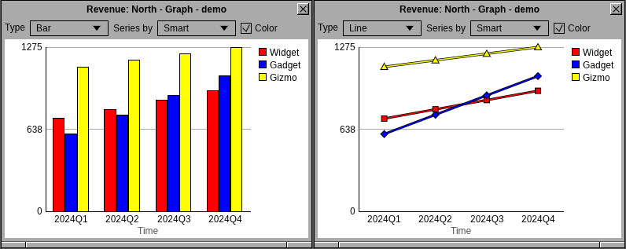

*The same worksheet as a Bar graph and as a Line graph, in color.*

## Scrollers

NeXT's scrollers: a gray trough with a raised knob, and the arrow buttons
grouped at one end (the bottom of a vertical scroller, the left of a
horizontal one). An arrow scrolls a line; **Alt+click** an arrow scrolls a
whole view, less a line so the last one stays in sight (NeXT's
Alternate-click). A click in the trough makes the knob jump there; drag
the knob to scroll continuously.

## Keyboard and screen readers

Everything works from the keyboard. In a worksheet the arrows move, typing
replaces the cell's value, Enter or F2 edits it, Enter commits and Esc
cancels; `[` and `]` page. The grid's own keys (`h j k l n [ ]`) keep
their jobs, so a text value that starts with one is typed after Enter. Tab moves
through the menu, the windows' fields and buttons, and Enter or Space
presses the focused one, so **Tab** to a menu item and **Enter** opens
its submenu or runs it. The key equivalents work anywhere outside a text
field. **Help ▸ Keys…** lists them all.

### Key equivalents

NeXT's Command key is **Ctrl** on Linux, the BSDs, illumos and Windows,
and **Cmd** on macOS. The letters are Improv 1.0's (from its main menu)
and NeXTSTEP's reserved ones; a capital means Shift too.

| Keys | Command | Menu |
| --- | --- | --- |
| Ctrl+? | Context Help… | Info |
| Ctrl+O | Open… | File |
| Ctrl+N | New | File |
| Ctrl+S | Save | File |
| Ctrl+Shift+S | Save As… | File |
| Ctrl+Shift+W | Close | File |
| Ctrl+Z | Undo | Edit |
| Ctrl+Shift+Z, Ctrl+Y | Redo | Edit |
| Ctrl+X | Cut | Edit |
| Ctrl+C | Copy | Edit |
| Ctrl+V | Paste | Edit |
| Ctrl+A | Select All | Edit |
| Ctrl+\[ | Select Items Only | Edit |
| Ctrl+\] | Select Cells Only | Edit |
| Ctrl+Shift+F | Format Panel… | Format |
| Ctrl+P | Print… | main menu |
| Ctrl+R | Recalculate | Worksheet |
| Ctrl+Shift+V | New View | View |
| Ctrl+W | Close Window | View |
| Ctrl+/ | Swap Rows/Columns | View |
| Ctrl+H | Hide | main menu |
| Ctrl+Q | Quit | main menu |

Improv's Ctrl+T (Font panel) belongs to a command not built yet, so it
does nothing. Ctrl+W is NeXTSTEP's reserved Close for the key window; here
it closes the focused worksheet window, as View ▸ Close Window does.

## Selecting

Click a cell to select it; Shift+click, Shift+arrows or a drag select a
range of cells. Click an **item** (a row or column heading) to select it
**and its cells**, the whole row or column; Shift+click another item
extends to it. On stacked categories, an outer item selects its group:
every row or column under it. **Edit ▸ Select All** (Ctrl+A) selects every
item and cell.

**Edit ▸ Select Items Only** (Ctrl+\[) keeps the selection's item names and
lets its cells go (the cells are no longer shaded): Copy then copies the
names, a line each, Cut copies them (an items-only selection cannot be
cut), and Paste and the Sum are refused. **Edit ▸ Select Cells Only**
(Ctrl+\]) keeps the cells. The plain `[` and `]` still page.

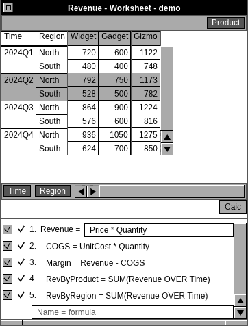

*Region stacked under Time: a click on the outer item 2024Q2 selects its
group, the North and South rows and their cells.*

## Copy and paste

**Edit ▸ Copy** (Ctrl+C) puts the worksheet's selection on the clipboard
as text, a tab between cells and a line per row, the way the cells show,
so it pastes into another spreadsheet or a text editor. **Edit ▸ Paste**
(Ctrl+V) writes tab-separated text into an input measure from the cursor
right and down, stopping at the grid's edge (the status line says how
many values were clipped there, as Improv warned); an empty field clears
its cell. Each value must be one the cell takes (`1,500` and `$1,500` are
fine in a number cell), or nothing is pasted and the status line says
which value it refused. A paste is one undo step. Derived cells are
computed, so a paste there is refused. **Edit ▸ Cut** (Ctrl+X) copies the
selection as Copy does and clears its input cells, as one undo step; on a
derived measure use Copy.

Every control has an accessible name (through AccessKit, which egui feeds
to Orca, VoiceOver and Narrator): menu items by their label, a cell by
its row and column items and its value (`2025, WidgetA: 100`), a tile by
its category and axis, and text fields by what they ask for. The four
grays meet WCAG contrast: black text is 21:1 on cells and 9:1 on panels,
white tile text 7.5:1.

## Context help

**Info ▸ Context Help…** (Ctrl+?) opens the Help window on the page for
the window in front: the Inspector's page when the Inspector was the last
window clicked, the worksheet's when a worksheet was. **Info ▸ Point for
Help** turns the pointer into a question mark: the next click opens the
page for what it lands on (the menu, a panel, or a worksheet's tiles, grid
or formula pane) and does nothing else; Esc cancels. Each page is a few
lines, with **More in the User Guide** to open its section of this guide
and its own **Point for Help** button. Help ▸ Functions… (F1) is the
function browser.

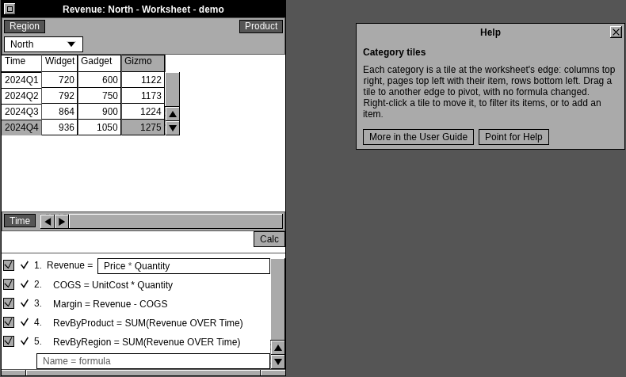

*Point for Help, then a click on the worksheet's Product tile: the Help
window opens on the page for category tiles.*

## Function help

**Help ▸ Functions…**, or F1 from anywhere (a formula edit included), opens
the Functions window at the workspace's right: a search line, the matching
functions grouped by category with their signatures, and the selected
one's details. The search matches names, aliases and descriptions, best
first (`pmt` finds PMT, then IPMT, PPMT, …; `payment` finds them by
description). Up and Down move the selection. The details show the
signature with the parameter names (`PMT(rate, nper, pv, [fv], [type])`,
`[optional]`, `…` repeating), the category and aliases, the description,
and the argument types. **Insert**, a double-click or Enter puts `NAME(`
into the formula you were editing (the selected row's, else the
`Name = formula` line), at the caret, and returns the keyboard to it.

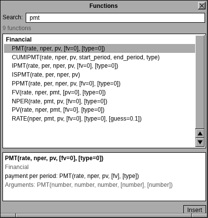

*Searching `pmt`: PMT first, then the functions whose names or
descriptions match.*

## Autocomplete

Both formula editors complete as you type. Start a name (`PM`, `Qua`, or a
quoted `'Unit`) and a list drops under the edit: matching functions with
their signatures and a dimmed one-line description, then the model's
measures and categories, at most eight. Up and Down move the selection;
Tab or Enter accepts it, Esc closes the list. With the list closed, Enter
commits the formula as before. Accepting a function writes `NAME(` with
the caret after the `(`; a measure or category named with spaces is
quoted for you (`'Unit Cost'`).

While the caret is at the end of the text, the rest of the selected name
and its parameters trail it in light gray (`PM` shows `T(rate, nper, pv,
[fv], [type])`). Inside a call the parameters still to give trail it: after
`PMT(0.05, ` they read `nper, pv, [fv], [type])`. A tooltip over the edit
shows the signature with the argument the caret is in **bold and
underlined**, the description and the category.

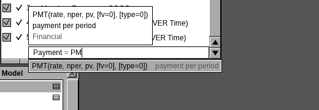

*Completing `PM`: the list under the edit, the signature tip above it.*

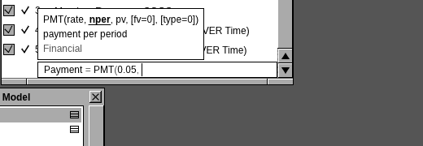

*Inside the call: the tip marks the argument the caret is in.*

## Formula errors

When a formula fails, the place it fails is underlined in the editor, and
under the row are the message and, dimmed, why. The editor keeps the
keyboard, with the caret at the start of the underlined part, so you can
correct it and press Enter again:

- an unknown measure or category: `did you mean Price?`, the nearest names
  in the model (a misspelled function's suggestion is in the message
  itself: `unknown function: PMTT; did you mean PMT?`);
- the wrong number of arguments: the call's name is underlined, the
  message spells the parameters, and the hint says what is off,
  `missing pv: 2 given`;
- a `(` never closed: that `(` is underlined, `( opened here is never
  closed: add )`;
- an aggregation without `OVER`: its form, `IRR(values OVER T,
  [guess=0.1])`.

A type or dimension error has no position, so the editor underlines the
first function or measure the message names (in `Quantity + LEN(Price)`,
`LEN`). A row whose saved formula no longer compiles shows its error the
same way. Editing the text clears the mark.

## Stacked axes

Drag the **Region** tile from the top-left pages strip onto the bottom row strip and the
row axis becomes the *stacked* product of Time × Region:

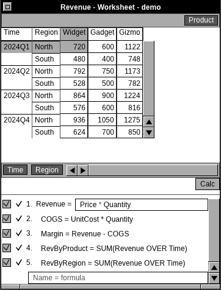

Each Time group (2024Q1, 2024Q2, …) now expands into its Region rows
(North / South), with the outer Time label printed once per group. Any number of
categories can stack on either axis; the grid renders the full Cartesian
product, and rows are **virtualized** so a stacked axis of millions of lines
stays responsive.

## Incremental recalculation

Editing an input cell propagates as a delta through differential dataflow — only
the touched cells and their dependents recompute. The same behavior on the CLI:

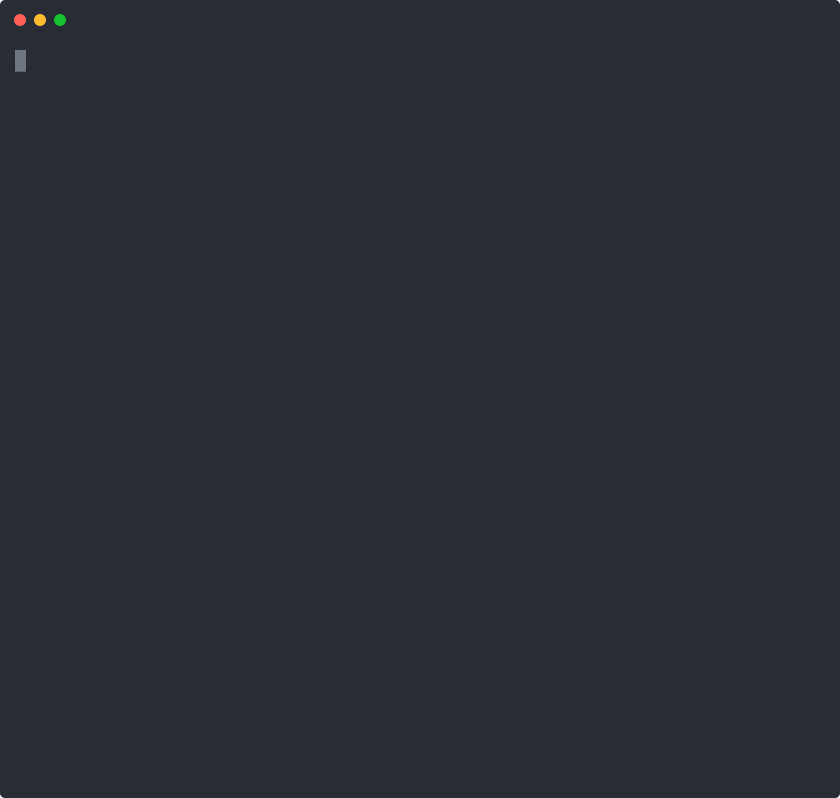

## A model in Postgres

The GUI opens a model stored in Postgres from its URL,
`improv-gui 'postgres://me@127.0.0.1/sales?sslmode=disable&model=plan'`. Input
measures bound to a table show that table's rows, and editing a cell updates
the row. Here the price of Q1 Widget was changed in SQL, and the GUI shows
the recomputed revenue (1200):

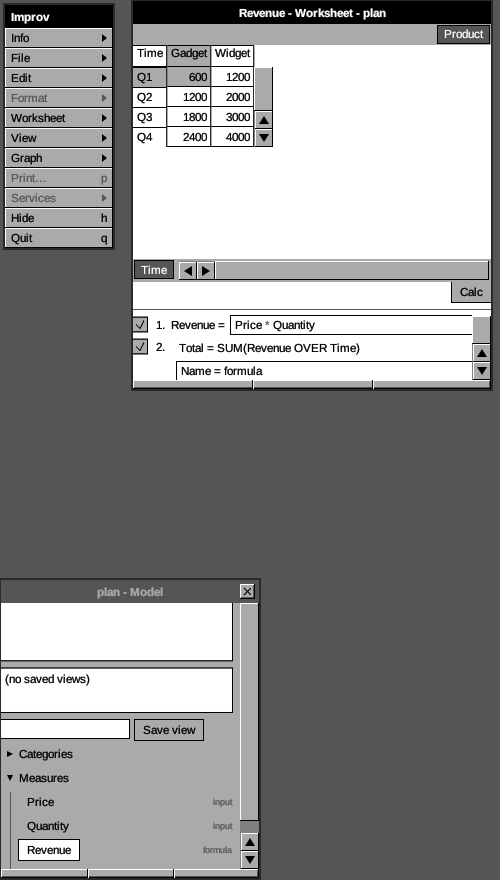

## A model on a server

The GUI opens a model that `improv-server` serves from its URL:

```sh
IMPROV_API_TOKEN=$TOKEN improv-gui https://improv.example.com
improv-gui 'https://improv.internal:3443?sslrootcert=/etc/improv/ca.pem'
improv-gui http://127.0.0.1:3000          # http:// only on this machine
```

The window then runs the [web GUI](./web-gui.md)'s worksheets, natively:
the same windows, gutters, formula pane, menus and Model Browser, in the
same NeXT look, over the server's `/v1` API. The server keeps the model
and the engine; the GUI computes nothing and holds only what it shows.
As the user the token names, under the model's [access
policies](./policies.md):

- What the policies hide (a measure, an item, a cell) is absent, not
  blank. A derived measure whose formula reads a hidden one shows
  without its formula.
- Derived cells and totals are the server's, computed over everything.
- What the user may not do is greyed out (the server's capabilities):
  the menus, the Model Browser's buttons, the formula lines and the
  cells. The server still checks every request, and a refusal says why
  on the status line; a refused cell shows the server's value again.
- Changes made elsewhere (another GUI, the CLI, a browser) show as they
  happen, from the server's change stream; the status bar says `live`
  while it is connected, and it reconnects by itself.
- The keyboard works as in the web GUI: Tab reaches each grid at its
  cursor cell, the arrows, Home and End move it, and Enter or typing
  edits it (see [the web GUI's Accessibility](./web-gui.md#accessibility)).
  The desktop's own AccessKit bridge gives a screen reader the same grid,
  names and announcements.

The token comes from `IMPROV_API_TOKEN`, or the window asks for it; it is
held in memory, never written down. `https://` is always verified, against
the operating system's CAs, or with `?sslrootcert=FILE` only that CA.
`http://` is refused for any host but this one, so a token never crosses a
network in cleartext; a proxy (`HTTPS_PROXY`, `ALL_PROXY`, minus
`NO_PROXY`) is used only for `https://` off this machine.

**A server model is a reduced view (0.15).** The title bar says
`(server view)` and the status bar `Server view:`. It has the web GUI's
commands, not the whole desktop app's: no graphs, printing, Inspector,
Format panel, CSV wizard, context help, function help, scenarios, item
filters, range selection or Copy and Paste
(see the web GUI's [What it does not do yet](./web-gui.md#what-it-does-not-do-yet)).
Those commands are greyed in the menu, and a key equivalent for one says
on the status line that it is not in the server view yet. The full
desktop app over a server is on the plan (road-to-1.0 I4).

## Platforms

| Platform | Status |
|---|---|
| Linux (Wayland, X11) | Builds and runs. |
| FreeBSD | Builds and runs (X11). |
| illumos (Solnix) | Builds with `ci/solnix-gui.sh` (below); runs in a Solnix COSMIC (Wayland) session. |
| Windows 11 (x64, arm64) | Builds and runs; arm64 tested on santorini, x64 in CI. |
| macOS | Builds and passes its tests in CI. |

### illumos

eframe draws with OpenGL through glutin, and glutin 0.32's EGL and GLX
crates leave illumos out of their target lists, so it does not compile
there as published. Until a glutin release has the fix
(`docs/reviews/patches/glutin-illumos.patch`), build on a Solnix host
with:

```sh
ci/solnix-gui.sh build --release   # or: ci/solnix-gui.sh test
UMEM_OPTIONS=backend=mmap target/release/improv-gui sample.db
```

The script vendors the locked crates (`cargo vendor --locked`), applies
Solnix's illumos fixups to them (the ones its own COSMIC applications are
built with, found from the installed `cosmic-comp`), then the glutin
patch, and builds with `--locked --offline` against the session's
libxkbcommon, Wayland and Mesa. It needs rustup's
`x86_64-unknown-illumos` toolchain, gcc and an installed COSMIC session;
it vendors again only when `Cargo.lock` or the patch changes.
`UMEM_OPTIONS=backend=mmap` is there because libumem's default allocator
backend fails the renderer's first large allocation.

## Recording the movie and screenshots

`docs/demo/gui-movie.sh` rebuilds the demo model, runs the GUI on a headless
X server and records the movie above with `ffmpeg`, driving it with
`xdotool`. `docs/demo/gui-stills.sh` takes this page's screenshots the same
way, in one run. `scripts/gui-shot.sh` takes the screenshot the CI compares
against its golden image. See `docs/demo/README.md` for what each needs.
