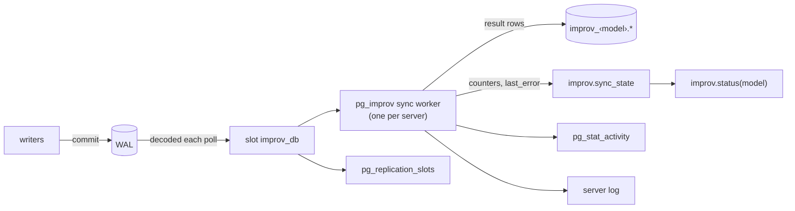

# Monitoring

This page is for whoever runs a Postgres database with `pg_improv` in it,
and for anyone running `improv-server`. It covers what to watch, what the
signals mean, and when to page someone. It describes `pg_improv` 0.11.0,
the version on `main`.

Ready-made files:

- [`docs/ops/postgres_exporter-queries.yaml`][queries]: custom queries for
  [postgres_exporter](https://github.com/prometheus-community/postgres_exporter),
  exposing every model's status, the slot and the worker as metrics.
- [`docs/ops/grafana-improv.json`][dashboard]: a Grafana dashboard over
  those metrics.

Both were checked against a PG 18.6 cluster running pg_improv 0.11.0
built from `main`, with postgres_exporter 0.17.1.

## What to watch



Only `logical`-mode models have a worker, a slot and lag. `trigger` and
`commit` models fail inside the writer's transaction, so the writer sees
the error. A `manual` model changes only when someone calls
`improv.recalc()`.

## `improv.status(model)`

One row per model, `SECURITY INVOKER`, readable by anyone with `USAGE` on
schema `improv` and `SELECT` on its tables.

```sql
SELECT m.name, s.*
  FROM improv.model m, improv.status(m.name) s;
```

| Column | Type | Meaning | Healthy |
| --- | --- | --- | --- |
| `sync_mode` | text | `logical`, `trigger`, `commit` or `manual`. | what you set |
| `slot` | text | `improv_db` in logical mode (the slot every logical model of the database shares); NULL otherwise. | `improv_db` |
| `lag_bytes` | bigint | `pg_current_wal_lsn() − confirmed_flush_lsn` of the slot: WAL the worker has not confirmed yet. It is the **slot's** lag, so every logical model of the database shows the same number. NULL when the slot does not exist (not yet created, or dropped). | small and not growing; it rises to about 16 MB while the bound tables are idle and then drops, because the worker advances an idle slot once it lags 16 MB |
| `confirmed_lsn` | text | The slot's `confirmed_flush_lsn`. | moving |
| `last_applied_at` | timestamptz | When the worker last applied a batch to this model, or rebuilt it. It does not move while the model's tables are idle. NULL before the first catch-up, and after a new slot resets progress. | recent if the tables are being written |
| `rows_applied` | bigint | Result rows the worker has written for this model (inserted, updated or deleted), in total. | rising with writes |
| `last_error` | text | Why the worker's last attempt at this model failed; NULL after a success. While set, the model is retried with backoff (0.5 s, doubling, up to 60 s), and every retry is a full rebuild. | NULL |
| `incremental_applies` | bigint | Batches the worker fed to the live engine (the cheap path). | rising with writes |
| `rebuilds` | bigint | Full reloads and recomputes. The first catch-up counts one; so does each worker restart, structural change (`define`, a new binding), and batch that needs one ([Concepts](./concepts.md#incremental-recalculation) lists the triggers). | flat between deploys and restarts |

`lag_bytes` is measured against the shared slot, so it does not tell you
which model is slow. Compare `last_applied_at` and the counters across
models for that.

`improv.status` does not report the slot's `wal_status`. A lost slot (see
below) leaves `last_error` NULL on 0.11.0 and earlier, so watch
`pg_replication_slots` as well. D11 in the [road to 1.0][plan] makes the
worker report and repair it.

## `pg_replication_slots`

```sql
SELECT slot_name, active, active_pid, wal_status, safe_wal_size,
       pg_size_pretty(pg_wal_lsn_diff(pg_current_wal_lsn(), restart_lsn))         AS retained,
       pg_size_pretty(pg_wal_lsn_diff(pg_current_wal_lsn(), confirmed_flush_lsn)) AS unconfirmed
  FROM pg_replication_slots
 WHERE slot_name = 'improv_db';
```

- **`retained`** (`pg_current_wal_lsn() − restart_lsn`) is what the slot keeps
  on disk in `pg_wal`. This is the number that fills disks.
- **`unconfirmed`** is `lag_bytes` from `improv.status`.
- **`active`** is true only while the worker is decoding (during a poll),
  so it flickers; `active_pid` is the worker's pid then.
- **`wal_status`** is `reserved` or `extended` while the slot is healthy.
  `unreserved` means it is past `max_wal_size` and about to exceed
  `max_slot_wal_keep_size`. `lost` means Postgres removed WAL the slot
  needed: the slot is dead, results no longer follow writes, and on 0.11.0
  and earlier the worker does not recover by itself
  (see the operations runbook).
- **`safe_wal_size`** is how much more WAL may be written before the slot
  is lost (NULL when `max_slot_wal_keep_size` is unlimited, which is the
  Postgres default; set it).

With no logical-mode model left, the worker drops the slot. A database
whose models are all `trigger`, `commit` or `manual` has no `improv_db`
row.

## The worker in `pg_stat_activity`

```sql
SELECT pid, datname, backend_start, state, wait_event_type, wait_event
  FROM pg_stat_activity
 WHERE backend_type = 'pg_improv sync';
```

- There is one worker per server, serving the database named by
  `improv.database` (default `postgres`). It exists only when `pg_improv`
  is in `shared_preload_libraries`.
- No row means the worker is not running. Without the preload there is
  never one; with it, the postmaster restarts a dead worker 5 s after it
  exits.
- `backend_start` keeps resetting when the worker is crash-looping.
- Between polls it waits on the latch: `wait_event_type = 'Extension'`,
  `wait_event = 'Extension'`.
- `datname` is the database it serves. Logical-mode models in any other
  database are never applied.

## The worker's log lines

The worker logs at `LOG` level into the server log. Every line starts with
`pg_improv sync`. Here is each line in `crates/pg_improv/src/worker.rs`:

| Line | Meaning | Action |
| --- | --- | --- |
| `pg_improv sync worker started on database "<db>"` | The worker connected. Once at server start, and after each restart. | none; frequent restarts mean a crash loop |
| `pg_improv sync worker stopping` | It received SIGTERM (shutdown, or `pg_terminate_backend`). It exits with status 1, so the postmaster starts it again 5 s later. | none |
| `pg_improv sync: listing models: <error>` | It could not read the catalog this poll. | check the error; it retries next poll |
| `pg_improv sync: dropping improv_db: <error>` | No logical model is left, and dropping the slot failed. | drop it by hand if it stays |
| `pg_improv sync: creating the slot improv_db: <error>` | Slot creation failed, usually `max_replication_slots` reached or `wal_level` not `logical`. No logical model is updated until it succeeds. | fix the setting and restart |
| `pg_improv sync: creating the publication improv_db: <error>` | The publication was missing (dropped by hand) and recreating it failed. | run `SELECT improv.sync_publication()` and read its error |
| `pg_improv sync: resetting progress: <error>` | A new slot was created, and resetting the models' recorded positions failed. | check the error |
| `pg_improv sync: reading improv_db: <error>` | Decoding the slot failed, so **no model was updated this poll**. Repeated every poll with `can no longer access replication slot "improv_db"` and `invalidated due to "wal_removed"` in the detail, it means the slot is lost. | operations runbook |
| `pg_improv sync: model <name>: <error>` | That model's apply failed. The same text is in its `last_error`, and it is retried with backoff. The other models are not held back. | operations runbook |
| `pg_improv sync: model <name>: rebuilding (model changed)` | Its structure changed (`define`, `bind_*`), so it is rebuilt from its tables. | none; expected after a deploy |
| `pg_improv sync: model <name>: rebuilding (<reason>)` | The batch could not be applied incrementally. The reasons are listed below. | if it repeats, see the operations runbook |
| `pg_improv sync: advancing improv_db: <error>` | The slot could not be moved forward. The models' results are already written, but WAL is retained until the next successful advance. | check the error |
| `pg_improv sync: dropping queued slots: <error>` | An old per-model slot (`improv_<model>`, from 0.10.0) left by the upgrade could not be dropped. | drop it by hand |

Rebuild reasons (in `crates/pg_model/src/live.rs` and `worker.rs`):

| Reason | Cause |
| --- | --- |
| `model changed` | `model_version` moved while the batch waited for the model's lock |
| `no live state` | first batch after a restart or a failure |
| `new item in a category a formula enumerates` / `new item` | a new dimension value in a category whose item list a formula reads (`POSITION`, `PREV`, `RANK`, `FILL`, …) |
| `two rows on one coordinate` | a measure bound without `agg` got a second row for one coordinate; bind it with `agg` |
| `min or max of text` | a text `min`/`max` binding changed (collation order is Postgres's) |
| `truncate` | `TRUNCATE` of a bound table |
| `old row not replicated`, `unchanged TOAST value`, `bound column missing` | an UPDATE or DELETE whose old row the decoder did not carry; the table needs `REPLICA IDENTITY FULL` (the worker sets it on tables without a primary key) |
| `value the loader would not read`, `a fold went out of step`, `fold not seeded`, `unknown binding`, `unknown measure`, `undescribed relation`, `not an aggregated binding`, `no row` | internal consistency checks; the rebuild makes the result exact again. If one repeats, report it with the model's definition |

**Log volume on 0.11.0 and earlier.** Every poll decodes the slot, and
Postgres itself logs two `LOG` lines per decoding call, each with a DETAIL
and a CONTEXT line: `starting logical decoding for slot "improv_db"` and
`logical decoding found consistent point at …`. It does this even when
nothing has changed. Measured on PG 18.6 (both PG 17 and 18 log these at
`LOG`): about 3.6 KB/s of server log at the default `improv.poll_ms = 200`
(about 310 MB a day), and 13.5 KB/s at `poll_ms = 50`. Rotate the server
log (`log_rotation_size`, `log_rotation_age`, or logrotate), and do not
lower `poll_ms` below what you need. `log_min_messages` cannot hide these
lines without hiding the worker's own `LOG` lines as well. D8 in the
[road to 1.0][plan] skips the decode when there is no new WAL and quiets
it, fixing this in 0.11.

**Changing `improv.poll_ms` / `improv.max_changes`.** Both take effect on
`pg_reload_conf()` in 0.11 (D9). On 0.10.0 and earlier, and on `main`
before D9 lands, the running worker keeps its old values until it
restarts:
`SELECT pg_terminate_backend(pid) FROM pg_stat_activity WHERE backend_type = 'pg_improv sync'`
(it is back 5 s later, and loses nothing).

## Alerts

Thresholds are starting points (one poll is 200 ms). Tune them to your
write rate.

| Alert | Condition | For | Severity | Why |
| --- | --- | --- | --- | --- |
| Worker down | no `pg_stat_activity` row with `backend_type = 'pg_improv sync'`, with the preload configured | 1 min | page | no logical model is updated; WAL accumulates |
| Worker crash loop | worker `backend_start` younger than 60 s, three times in 10 min | 10 min | page | something kills it every poll; read the server log |
| Slot about to be lost | `wal_status = 'unreserved'` for `improv_db` | 0 | page | the next checkpoint may invalidate it |
| Slot lost | `wal_status = 'lost'` for `improv_db` | 0 | page | results have stopped; status stays clean. This is the only signal on 0.11.0 and earlier |
| Retained WAL high | retained bytes > 50 % of `max_slot_wal_keep_size` (or of free space on the `pg_wal` volume if unset) | 10 min | warn | the worker is behind or stopped |
| Lag growing | `lag_bytes` > 64 MB and rising | 15 min | warn | an idle slot stays at or below 16 MB; more than that, rising, means the worker is not keeping up |
| Model failing | `last_error IS NOT NULL` | 5 min | warn (page if it is a business-critical model) | the model's results are stale and every retry is a full rebuild |
| Rebuilds rising | `rebuilds` increases by more than 3 in 15 min outside a deploy | 15 min | warn | a rebuild loop: each costs a full recompute |
| Stale model | `last_applied_at` older than 10 min while its bound tables were written (`n_tup_ins + n_tup_upd + n_tup_del` in `pg_stat_user_tables` moved) | 10 min | warn | the worker is not reaching this model |
| Commit/trigger failures | the server log shows `improv: model … could not recompute` | any | warn | writers' transactions are being rolled back |

As PromQL over the [queries file][queries] (metric names are
`<query>_<column>`):

```yaml
groups:
- name: pg_improv
  rules:
  - alert: ImprovWorkerDown
    expr: pg_improv_worker_running == 0
    for: 1m
    labels: {severity: page}
  - alert: ImprovSlotLost        # wal_status unreserved or lost
    expr: pg_improv_slot_at_risk == 1
    labels: {severity: page}
  - alert: ImprovRetainedWalHigh
    expr: pg_improv_slot_retained_bytes > 2 * 1024^3   # half of a 4 GB max_slot_wal_keep_size
    for: 10m
    labels: {severity: warn}
  - alert: ImprovLagGrowing
    expr: pg_improv_status_lag_bytes{sync_mode="logical"} > 64 * 1024^2
          and deriv(pg_improv_status_lag_bytes{sync_mode="logical"}[15m]) > 0
    for: 15m
    labels: {severity: warn}
  - alert: ImprovModelFailing
    expr: pg_improv_status_last_error == 1
    for: 5m
    labels: {severity: warn}
  - alert: ImprovRebuildsRising
    expr: increase(pg_improv_status_rebuilds[15m]) > 3
    labels: {severity: warn}
```

Run postgres_exporter against the database named by `improv.database`,
with `--extend.query-path=postgres_exporter-queries.yaml`, and as a role
that has `USAGE` on schema `improv`, `SELECT` on its tables, and
`pg_monitor`.

## The HTTP server

`improv-server` ([The HTTP Server](./server.md)) serves one model store.

- **Health:** `GET /health` returns `200 ok` without a token. It says the
  process is up and accepting requests. It does not open the store, so
  pair it with a periodic authenticated `GET /measures` if you need to
  know the model loads.
- **Scheduler:** `GET /scheduler/status` (token required) returns
  `{"enabled", "tick_secs", "last_tick_refreshed", "last_error"}` when
  `IMPROV_SCHEDULER=1`. Alert on a non-null `last_error`.
- **Logs:** plain lines on stderr, with no timestamps, so capture stderr
  with your supervisor (systemd's journal adds the time):

| Line | Meaning |
| --- | --- |
| `improv-server listening on <addr>` | started |
| `auth disabled: set IMPROV_API_TOKEN to require a bearer token` | open mode (loopback, or `IMPROV_ALLOW_OPEN=1`) |
| `improv-server: <error>` | startup failed (bad address, refused open mode); it exits |
| `accept: <error>` | a connection could not be accepted (often file descriptors exhausted) |
| `request <id>: internal error: <detail>` | a 500; the client got `{"error": "internal error", "request_id": <id>}` with the same id |
| `scheduler disabled (set IMPROV_SCHEDULER=1 to enable)` | the default |
| `scheduler: refreshing due CALL measures every <n>s` | scheduler on |
| `scheduler: IMPROV_EXTFN_ALLOW unset; no function will run` / `cannot read IMPROV_EXTFN_ALLOW …` | scheduler on but nothing allowed |
| `scheduler: WARNING skipping measure <id>: its function is not in the IMPROV_EXTFN_ALLOW allowlist` | a function's digest is not allowed |
| `scheduler: [<t>s] refreshed measure <id> (<n> cells)` | a refresh ran |
| `scheduler: measure <id> refresh failed: <error>` / `scheduler: tick error (continuing): <error>` | a refresh failed; the server keeps running |

- **Signals in responses:** 409 means another writer saved since the server
  loaded (the next request reloads). 408 and 413 mean the request limits
  were hit. A rising 409 rate means two writers are fighting over one
  model.

[queries]: https://codeberg.org/gregburd/improv/src/branch/main/docs/ops/postgres_exporter-queries.yaml
[dashboard]: https://codeberg.org/gregburd/improv/src/branch/main/docs/ops/grafana-improv.json
[plan]: https://codeberg.org/gregburd/improv/src/branch/main/docs/reviews/2026-10-21-road-to-1.0.md
